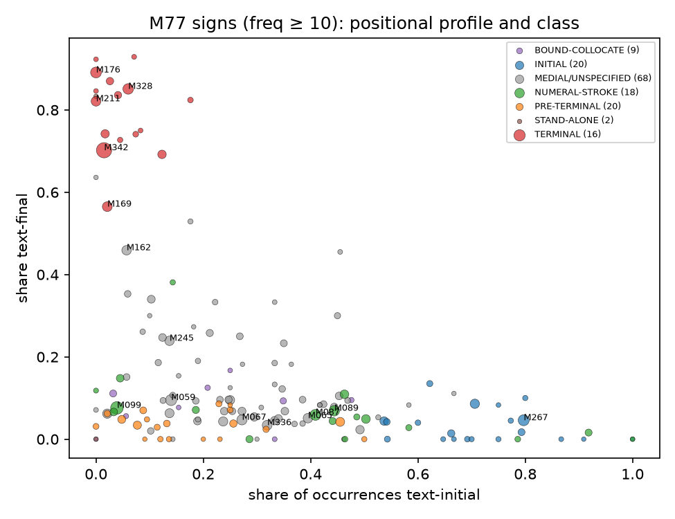
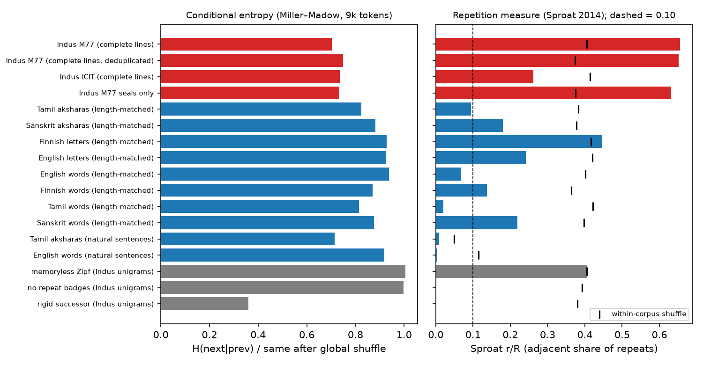
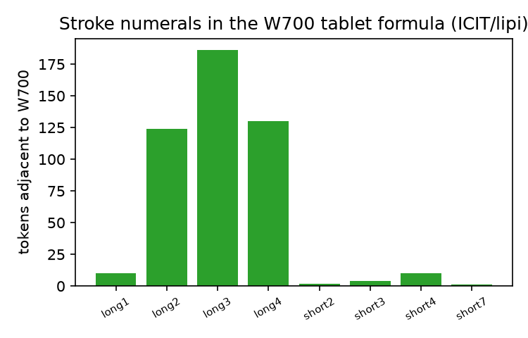
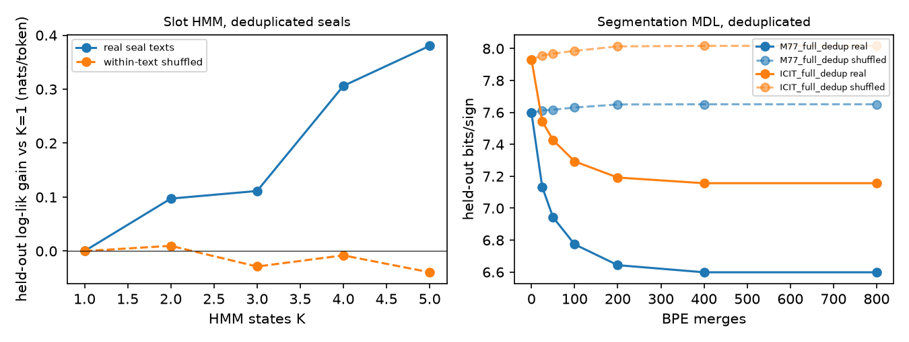
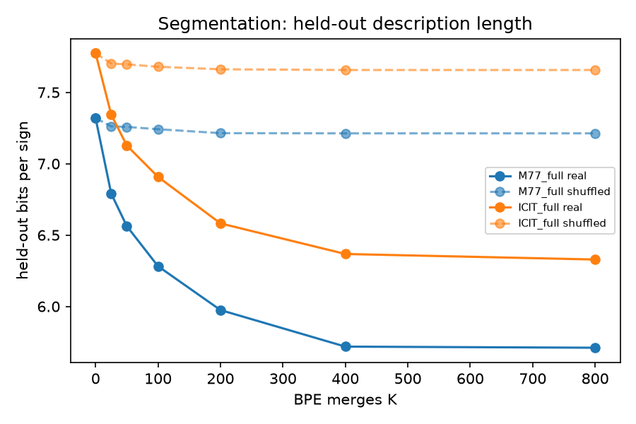
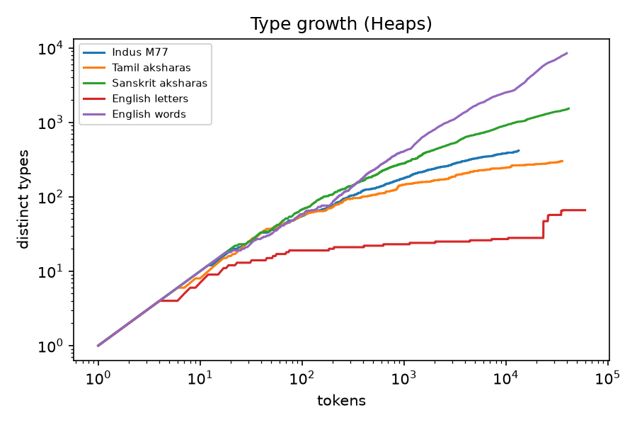

UNREVIEWED PREPRINT / WORKING DRAFT. This manuscript has not been peer-reviewed. Results are provisional and may change.

# Abstract

We re-examine the Indus script using two independent machine-readable transcriptions: Mahadevan's 1977 concordance (M77; 3,573 lines, 13,372 sign tokens, 417 sign types) and an ICIT-derived corpus (Wells/Fuls numbering, distributed in the *lipi* repository). Every quantitative claim is calibrated against a null model: within-line shuffles, global shuffles, permuted keys, length-matched Markov nonsense or memoryless generators, as appropriate. Every claim is also checked on held-out data, on de-duplicated data, or by cross-corpus replication.

1. **Positional classes.** Text-final (terminal), text-initial and pre-terminal sign classes are robust. Their false-discovery rates against shuffles are 0.002, 0.003 and ~0, and 87.5% of terminal-class signs replicate in the second corpus. Thirty-eight signs reach a positional-class confidence of at least 85%; 28 of these also replicate across corpora.
2. **Slot grammar.** A hidden Markov model of seal texts recovers a reproducible slot template: initial → post-initial → medial → terminal → post-terminal. It gains 0.38 nats/token on held-out, de-duplicated texts, against no gain on shuffled texts.
3. **Segmentation.** Byte-pair segmentation lowers held-out description length by about 1 bit per sign after de-duplication, against no reduction for shuffled texts. This shows that recurrent multi-sign units exist.
4. **Linguistic status.** Measures proposed to separate writing from non-linguistic symbol systems do not separate them at Indus text lengths. These are bigram conditional entropy (Rao), Sproat's repetition ratio r/R, and Lee et al.'s Cr/Ur. Linguistic comparanda cut to Indus lengths cross Sproat's boundary, and the two Indus transcriptions disagree with each other (r/R 0.66 vs 0.26). Linguistic status therefore remains **undetermined** by internal statistics.
5. **Published readings.** A sign-value key published by Yajnadevam gains nothing from real sign order on a full Sanskrit morphological parse (57.9% real vs 59.2% shuffled). On the same measure, correct keys for Sanskrit and Akkadian at Indus text lengths lose 17–25 points when order is shuffled (§4.22). On two weaker dictionary-segmentation measures the key shows small real-order gains (+0.4 and +2.2 points; p = .015 and .005 with 200 shuffles). Those gains come at a 94–99% ceiling, and correct keys show only modest gains on the same measures (session 7 correction: the earlier text said no measure distinguished real from shuffled order). Fitted rebus keys built from a Dravidian lexicon perform no better than keys built from English or Finnish, and about as well as nonsense lexicons (median rank 6 of 8 over 50 seeds; above Markov nonsense in 58% of seeds).
6. **Phonetic values.** We find **no sign whose phonetic value can be estimated above null**. The stroke numerals are an iconic, plate-checked exception, assessed qualitatively. A complete phonetic decipherment at 85% confidence is not supported by the available evidence.

7. **Full sign map (session 4).** We mapped all 417 M77 signs and 712 ICIT signs. Each entry gives cross-scheme IDs, allographs, positional profile, class, neighbours, sites, object types, glyph references, foreign look-alikes and published claims.
   - A distributional-plus-visual model recovers hand-made M↔W concordance links at 84.7% top-1 under cross-validation (chance 0.25%).
   - A visual check of 40 Carlson links, made by the project's AI research assistant (not a human epigrapher), judged 37 correct or plausible; an independent human check is still outstanding.
8. **Claims re-tested.** We compiled 42 hand-sourced sign-value proposals and two complete keys, and tested each per sign with held-out values or held-out sites.
   - No phonetic value beats the alternative-value, shuffled-corpus and alternative-lexicon nulls.
   - Yajnadevam's small per-sign advantage is comparable to that of short hill-climbed keys fitted to a shuffled or real corpus. Over 20 seeds the median difference is +0.009 in mean p (95% interval −0.040 to +0.052; Wilcoxon p = .054). The per-seed one-sided test is below .05 in only 2 of 20 seeds, about the 1 expected by chance (§4.9).
   - Twelve claim rows (nine distinct tests) have their implied **roles** replicate on sites outside Mohenjo-daro and Harappa: jar and arrow are final, M267 and M150 are initial, and numeral+fish, M087+fish and M267+M099 are units. These results do not discriminate between proposed sound values.
9. **Look-alikes.** Visual look-alikes in Linear Elamite, Egyptian, cuneiform, Brahmi and Linear A do not predict Indus sign function beyond the trivial resemblance of stroke numerals.
10. **Prior work re-run (session 5).** We replicated two published results on our data and added baselines they lacked.
   - Nair (2026): Zipf slope −1.40 to −1.44 (published −1.49) and bigram conditional entropy 3.43–3.60 bits (published 3.23), both far below within-inscription permutations (p = 0.001).
   - Yadav et al. (2010): the big unigram→bigram drop in held-out perplexity replicates (74.8 → 31.3; published 68.8 → 26.7). The further trigram and quadrigram gains do not appear on deduplicated texts in our implementation. Their 74% restoration "sensitivity" is matched by a frequency-only baseline (0.88), because the 90%-mass candidate set holds about 120 signs. Top-1 restoration is the informative figure: 0.34 for a bigram model against 0.12 for frequency alone.
   - A synthetic, non-linguistic emblem system (after Raghavendra 2026) passes every structural test we use: low conditional entropy, a bigram perplexity drop, restoration well above baseline and a held-out HMM slot gain. These tests therefore show **ordered structure, not language**, which is how we report them.
11. **Session 6: pre-registration, robustness and real non-linguistic comparanda.**
   - Eight structural predictions were committed publicly before testing (§4.13). Seven replicated in every primary held-out split with enough data (CISI transcription, ICIT regions and object types). **The numeral+fish unit (H7) only partially replicated**: it failed on ICIT pottery (p = 0.109).
   - All 90 positional and entropy tests pass across M77, ICIT and CISI under four sign-merge schemes (§4.14).
   - Against Sproat's real non-linguistic corpora, the Indus profile is mixed: emblem-like in order dependence, language-like in its low repetition rate. The session-6 "emblem-like edge effects" turned out to be an artefact of the windowed comparanda (§4.20). Linguistic status stays **undetermined** (§4.15).
   - A public claim-scoring benchmark finds no submitted key that beats all nulls (§4.16). We also release an open sign list and a blind rater kit (§4.17).
   - Control values are now deterministic, and their spread over seeds is reported (§4.6; extended to 20–50 seeds in session 7).

12. **Session 7: stricter controls.**
   - Seed-dependent claims were re-run over 20 seeds (per-sign leave-one-out) and 50 seeds (rebus keys). Yajnadevam's edge over fitted keys is not reliable. Dravidian rebus keys rank 6th of 8 lexicons (median) and are statistically indistinguishable from Markov nonsense and English (§4.6, §4.9).
   - The Linear Elamite look-alike excess survives complexity-matched nulls, BH correction across 10 scripts and a modern-font render check. Linear B, a script with no plausible link, also passes one of these controls, so we read the excess as a visual-style statistic and **not as evidence of a link** (§4.18).
   - An exploratory look at the two H7 failures points to low power (about 0.5 at n = 5), not heterogeneity. The pre-registered verdict is unchanged (§4.19).
   - We added short real linguistic texts: Latin inscriptions and Wikipedia titles. Language-vs-emblem classifiers are unstable under leave-one-system-out tests and reference changes, and they assign Indus no differently from synthetic emblem generators (§4.20).
   - A fresh-clone run of the full quick start reproduces the public outputs (§4.21).
   - **Positive control (§4.22).** Correct keys for Sanskrit and Akkadian lose 17–25 points under shuffling on the strong measures, even at about 4 signs per text. Yajnadevam's key loses nothing on the parse, but shows small significant gains on two weak measures, which corrects item 5.

# 1. Introduction

The Indus script (c. 2600–1900 BCE) survives on several thousand short inscriptions, chiefly seals, sealings and miniature tablets. Average lines are about four signs long (Mahadevan 1977; Rao 2010). There is no bilingual. Parpola (1994: 48) puts the methodological consequence directly: "in the absence of effective aids, such as extensive bilinguals, native lexica or descendants of the signs with known values, complete decipherments of logo-syllabic writing systems are usually impossible."

Statistical work has split into two camps:

- **Arguing for linguistic structure:** Yadav et al. 2009; Rao 2010.
- **Arguing that the inscriptions are a non-linguistic symbol system:** Farmer, Sproat & Witzel 2004; Sproat 2014.

Meanwhile, decipherment claims continue to appear. They include Dravidian (Parpola 1994; Mahadevan 2015; Mukhopadhyay 2019, 2021) and Sanskrit (the Yajnadevam *lipi* repository).

Our aim is narrower than decipherment. We ask what can be said about the script at a **stated, calibrated confidence**, and we test published readings with the same machinery. We deliberately separate three things:

- **(a) distributional facts.** These can be given probabilities against explicit nulls.
- **(b) functional interpretations**, e.g. "numeral" or "terminal marker". These are partly calibratable.
- **(c) phonetic or semantic values.** These are calibratable only if they beat null models, and in our tests none do.

## 1.1 Related work and what is new here

Table R1 compares this study with published work making similar claims. The full matrix is in `outputs/compare/prior_work_matrix.csv` (24 rows). Cells come only from sources we opened; where we saw only an abstract, the cell says so.

| Work | Corpus | Nulls | Held-out | Multiple-testing | Cross-corpus | Code | Main claim |
|---|---|---|---|---|---|---|---|
| Koskenniemi 1981 | n/s | n/s | n/s | n/s | n/s | n/s | syntactic segmentation framework (abstract only) |
| Parpola 1994 | CISI/M77-era | none | none | none | none | n/a | segmentation, classes, Dravidian readings |
| Farmer, Sproat & Witzel 2004 | whole corpus | comparative | none | none | none | n/a | non-linguistic system |
| Rao et al. 2009 (PNAS) | M77 subset | n/s | perplexity | n/s | none | n/s | Markov structure; restoration |
| Rao et al. 2009 (Science) | M77 subset | DNA, protein, Fortran, artificial | none | none | none | n/s | entropy "like language" |
| Yadav et al. 2010 | EBUDS 1,548 | random equiprobable | 5-fold CV | n/s | none | n/s | quadrigram saturation; restoration 74% |
| Fuls 2013 | ICIT 3,723 texts | n/s | n/s | n/s | n/s | DB gated | 7 positional classes (abstract only) |
| Sproat 2014 | many real non-linguistic corpora | real systems | n/s | n/s | yes | n/s | entropy measures non-discriminating |
| Mukhopadhyay 2019 | M77/ICIT observations | none | none | none | n/s | n/a | data-carrier syntax, not phonetic spelling |
| Nair 2026 | 1,916 dedup texts | 2 generators + 7 real corpora; 1,000 perms | sweeps | Bonferroni (variant) | no | public | Indus intermediate |
| Raghavendra 2026 | SIGIL 3,000 + Indus | synthetic emblem system, 54 methods | grouped held-out | Bonferroni | n/s | corpus released | measures non-specific |
| Kriger & Hunt 2026 | CISI/mayig Mohenjo-daro unicorn seals, 179 | global shuffle | none | none | none | n/s | positional constraints, sequence uniqueness, stroke numerals (re-tested in §4.25) |
| Diener 2026 | statistics from Kriger & Hunt 2026 | none | none | none | none | n/a | non-linguistic five-field "cargo-tag" records (tested in §4.25) |
| **This work** | M77 3,573 lines + ICIT 712 signs | shuffles, fitted/noise keys, alt lexicons, synthetic emblem | dedup CV, LOO, site-held-out | BH-FDR | yes (scored concordance) | scripts | structure yes; language undetermined; no value beats null |

n/s = not seen in the parts we read. Computational decipherments of other scripts (Snyder, Barzilay & Knight 2010; Luo, Cao & Barzilay 2019; Luo et al. 2021) are validated against known answers (Ugaritic, Linear B, Gothic). They need a known related language and, except Luo et al. 2021, word boundaries; Indus has neither. Image-recognition work (Palaniappan & Adhikari 2017; Dixit et al. 2025; Ganeriwala et al. 2025) solves a different task. A visual-similarity study (Reddy 2025) reports cosine similarities without a null; our look-alike tests (§4.11) suggest such resemblances do not carry function. A press survey (Roychowdhury, *Indian Express*, 12 Aug 2026) reports about 200 claims emailed to Rao and at least 60 to RMRL, and no agreed mechanism for evaluating them.

**Where prior work is stronger.**

- Fuls and Wells work from the full curated ICIT database, with a finer 695-sign list and archaeological context; we use a secondary, unlicensed derivative.
- Sproat (2014) and Nair (2026) have used real non-linguistic corpora for longer. We added Sproat's openly released corpora only in session 6 (§4.15), and Nair's set is not included.
- Raghavendra (2026) registers 54 methods against a synthetic control; our synthetic control covers only our own tests.
- Image-based recognition is outside our scope.

**What is new here.** As far as we can tell from the works we opened, no earlier study combines these five things:

1. Class membership reported as a calibrated probability (bootstrap stability × (1 − FDR against shuffles)), replicated across two independent transcriptions linked by a scored concordance (84.7% top-1 under cross-validation).
2. Duplicate-aware held-out tests for segmentation and slot grammar. Yadav et al. (2010) already removed duplicates; we add frequency and position baselines and report top-k rather than mass-set sensitivity.
3. Per-sign leave-one-out tests of published phonetic values against alternative-value, shuffled-corpus, alternative-lexicon and noise-fitted keys.
4. Site-held-out role tests: roles are learned on Mohenjo-daro and Harappa and tested on 641 texts from other sites, with BH correction.
5. A full M/W sign map with null-calibrated foreign look-alike tests.

None of these settles linguistic status, which our results, Sproat (2014) and Raghavendra (2026) agree internal statistics cannot do.

# 2. Data and provenance

| Corpus | Source | Units used | Access / licence |
|---|---|---|---|
| M77 | Mahadevan 1977 concordance, machine-readable export (joyboseroy/indus_decipher) | 3,573 lines; damage marker splits lines; 2,906 texts | ASI copyright; research use only |
| M77 object codes | Our OCR of the IA scan of Mahadevan 1977 (6-digit type/side/field/line/direction codes) | 2,601 of 2,906 texts (89.5%) | derived; research use only |
| ICIT-derived | *lipi* repository `inscriptions.csv` (commit fc8813a), Wells/Fuls numbering | 5,680 rows; 18,050 tokens; 712 sign codes | no licence; ICIT data are not open; private research use |
| Concordance M↔P↔W | M. Carlson's hand matches (mayig) | 1,532 rows | unverified, many-to-many |
| Weights | Sproat, `weights.xml` (Hemmy 1931–43; HARP) | 1,154 weights | GPL-3 |
| Dravidian lexicon | Merriam & Fuls, *Dravidian Database* v1.2 (Zenodo 22682542) | DEDR forms + 15,629 PDR | CC BY 4.0 |
| Sanskrit lexicon | Monier-Williams via csl-orig; vidyut 0.4 data | 172k reduced headwords; parser | CC BY-SA 4.0; MIT |
| Other lexicons | FrequencyWords (fi, tr, id, hu, en) | 50k lists | CC BY-SA 4.0 content |
| Comparanda texts | Random Wikipedia articles (ta, sa, fi, en), ~60 per language | 76k–277k characters | CC BY-SA 4.0 |

**Transcription rules.**

- M77 lines are in reading order. ICIT lines are stored in visual order and were reversed for reading.
- Damage codes (M77 `MSg0`; ICIT 000/999) split a line into undamaged stretches. "Complete lines" means undamaged lines with no split.
- Exact duplicate texts are common: 35% of M77 complete lines and 39% of ICIT complete lines. This inflates held-out scores (Bose 2026), so the key analyses were repeated on de-duplicated corpora.

**OCR of M77 object codes.**

- Glyphs were classified by a k-nearest-neighbour digit model trained on 17,000 automatically labelled glyphs.
- Held-out-page digit accuracy was 0.997–0.999, and agreement with an independent OCR pass was 99.3% on 1,822 overlapping texts.
- Single-sign direction codes matched line length in 53 of 53 checkable cases, with no false positives in 1,785.

**Plate checks.** The stroke numerals and fish signs were checked visually against the M77 sign-list plates (book pp. 32–38) by the project's AI research assistant, not by a human epigrapher. Crops are kept privately in `paper/evidence/` and are not for publication.

# 3. Methods

All code is in `scripts/` and all outputs in `outputs/`; file names are given in brackets.

## 3.1 Positional classes (`structure.py`)

For each sign with frequency ≥ 10 in M77 we computed shares of initial, final and solo occurrences, plus left/right context entropies. Classes were assigned by a fixed decision list, using one-sided binomial tests (α = 0.001) against corpus baseline shares:

| Class | Rule |
|---|---|
| TERMINAL | final share ≥ 0.5 and significant |
| INITIAL | initial share ≥ 0.5 and significant |
| PRE-TERMINAL | ≥ 50% of successors are terminal-class signs |
| STAND-ALONE | solo share ≥ 0.15 and ≥ 5 solo uses |
| BOUND-COLLOCATE | top right collocate ≥ 60% |
| MEDIAL/UNSPECIFIED | otherwise |

Calibration:

- **False-discovery rate per class:** the mean class count over 30 within-line shuffles, divided by the real count.
- **Stability:** the share of 100 bootstrap resamples of lines that give the same class.
- **Reported distributional confidence** = stability × (1 − FDR).
- **Replication:** the same rules applied to the ICIT corpus through the concordance, with positional classes compared.

Stroke signs were also tagged NUMERAL-STROKE by visual inspection (made by the AI research assistant, not a human). This tag is kept separate from their positional class.

## 3.2 Segmentation (`structure2.py`, `structure3_dedup.py`)

1. Byte-pair merges (K = 0–800) were learned on 80% of lines.
2. Held-out cost was scored as bits per sign under a unigram unit model, with unseen units spelled out sign by sign (add-½ smoothing).
3. The same procedure was run on within-line-shuffled corpora, and on de-duplicated corpora. Results are averaged over 3 splits.

## 3.3 Slot grammar (`structure2.py`, `structure3_dedup.py`, `structure_ling.py`)

- **Model:** categorical HMMs (hmmlearn), K = 1–6 states, fitted to complete seal texts (object type 1). Signs with training frequency < 5 were mapped to UNK, and an END symbol was appended to each text.
- **Main test:** held-out log-likelihood per token, real vs within-text shuffled.
- **Slot-order conformity test:** for K = 6 on de-duplicated seals, states were ranked by their mean relative position in training texts. For each held-out text we checked whether the Viterbi path is non-decreasing in slot rank. This was compared with held-out texts that were shuffled or reversed.

## 3.4 Script-type and linguistic-status measures (`structure_ling.py`)

**Inventory and coverage.** We report observed types, hapax counts, the Chao1 unseen-type estimate, and the number of types covering 80%/90% of tokens.

**Status measures.** Each was computed on 20 random subsamples of 9,000 tokens per system. Ranges are 2.5–97.5 percentiles over the subsamples, which reflect subsampling variability rather than a full bootstrap. The measures are:

- **Conditional entropy:** bigram H(next | prev) with boundary symbols and Miller–Madow correction. It is reported as a ratio to the same system after a global token shuffle with text lengths preserved. This ratio is 1 for a memoryless system and near 0 for a rigid one.
- **Normalised block entropies** B2 and B3 (cf. Rao 2010). We used the Miller–Madow estimator, not the NSB estimator of Nemenman et al. (2001) used by Rao and by Sproat, so B3 is undersampled.
- **Sproat's (2014) repetition ratio r/R.** R counts tokens repeating an earlier token in the same text; r counts those repeats that are adjacent to it. Sproat's linguistic/non-linguistic boundary is 0.10.
- **Lee et al.'s Ur and Cr** (a = 7), with their decision tree as quoted by Sproat (2014): Cr ≥ 4.89 counts as linguistic; Ur < 1.09 as segmental, < 1.37 as syllabic, otherwise logographic.

**Comparanda.**

- Linguistic texts: Tamil and Sanskrit graphemes (Unicode extended grapheme clusters ≈ aksharas), Finnish and English letters, and words in all four languages. Each was cut into windows whose lengths are drawn from the M77 line-length distribution ("length-matched"). Natural-sentence versions of Tamil aksharas and English words are included for reference.
- Non-linguistic baselines, all built from Indus unigram frequencies: memoryless Zipf; "merit-badge" texts without repetition (Sproat's example); and a rigid deterministic-successor model.

## 3.5 Claim harness (`claim_harness.py`, `parse_test_vidyut.py`, `rebus_harness.py`)

**Yajnadevam (lipi).** The key (716 sign entries, 129 distinct values) and the reading rules were taken from the repository's code. Four tests:

- **A. Reproduction of the published readings.**
- **B. Fixed-key segmentability** into Monier-Williams headwords and length-stratified lexicons.
- **C. Fitted keys** (hill-climbing over the same value inventory) for 8 lexicons, on held-out texts.
- **E. Full Sanskrit parse with vidyut**, comparing real order with shuffled order, a permuted key and Markov nonsense.

**Rebus/Dravidian.**

- Keys mapping the top 150 signs to 2–4-character lexical roots were fitted to maximise the share of adjacent sign pairs whose concatenation is an attested word. Scoring was on held-out texts, for each of 8 lexicons (2 seeds × 3 corpora: real, globally shuffled, within-text shuffled).
- Parpola's specific numeral + fish compounds were looked up in the Dravidian DB.

## 3.6 Anchors (`anchors.py`, `w700_weights.py`)

- Numeral value frequencies.
- The tablet formula: long-stroke numeral + W700.
- The weight ratio classes (Hemmy unit).
- Motif and site enrichment, with max-statistic permutation correction.
- West-Asian/Gulf sequences vs the Indus bigram space.
- Duplication by object type.

## 3.7 Full sign map and concordance scoring (`concordance.py`, `concordance_relabel.py`, `sign_map_full.py`)

**Glyph images.**

- Every M77 sign was cropped from the Mahadevan (1977) sign list (pp. 32–35): 416 of 417 signs; M049 is missing. Crops are placed from the OCR position of each row's labels.
- Every Wells-numbered sign was rendered from the SK Indus Script font (631 glyphs).
- Both image sets are **private research use only** (ASI copyright; the font is "All Rights Reserved").

**Visual similarity.** Glyphs are binarised and normalised to 48 × 48 pixels. Similarity is 0.5·exp(−chamfer/3) + 0.5·HOG cosine, taking the maximum over a horizontal mirror.

**Distributional profile.** Each sign is described by:

- solo, initial and final shares
- log frequency
- left- and right-neighbour vectors, projected onto anchor signs

**Anchors and cross-validation.**

- Anchors are the 118 one-to-one Carlson links with frequency ≥ 3 in both corpora.
- A logistic model on five features (left/right cosine, position difference, frequency difference, visual similarity) was trained with 5-fold cross-validation.
- It was evaluated by top-1 and top-5 accuracy among about 399 W candidates; chance top-1 is 0.25%.
- Per-fold and global Hungarian assignments were also computed.

**Scoring all 566 Carlson links.**

- Every link was ranked among the W candidates, with the other hand-matched variants of the same M sign excluded.
- Rare signs (no distributional rank) received a visual-only rank among all 631 W renders.

**Visual check (AI-made).** Forty links were inspected visually, M crop beside W render: the 20 the model scores lowest plus 20 at random. The inspection was made by the project's AI research assistant (an image-capable language model), **not by a human**. It is therefore not independent expert validation; a blind human check is planned (§6).

## 3.8 Claims table and per-sign leave-one-out tests (`claims_table.py`, `loo_signs.py`, `loo_hand.py`)

**Claims table.** We compiled every sign-value proposal we could source from documents opened in this project:

- Parpola (1994: 59–60, 181, 187–188, 194, 197, 215, 264, 276–277). These pages include his reports of the Knorozov team, Mahadevan's early work, Fairservis and Heras.
- Mahadevan (2015)
- Wells (2015, a caption only)
- Mukhopadhyay (2019, class-level only)
- the complete Yajnadevam key (714 signs, Sanskrit)
- an unsupervised optimal-transport key by Field Cady (99 signs, Dravidian syllables)

**Sign mapping.** Signs named only in figures were mapped to M numbers by glyph similarity on crops of the source chart. Each mapping carries a confidence.

**Phonetic keys.** For each sign in ≥ 5 unique clean ICIT texts, the proponent's value was held out. The statistic is the share of that sign's occurrences lying inside an attested word that spans a neighbouring sign. Attested words are those of ≥ 4 characters in a length-matched lexicon.

- The proponent's value was compared with every other distinct value in the same key (exact rank test). The rest of the key was held fixed.
- The statistic was then recomputed on within-text shuffles and with 7 alternative lexicons.
- It was also computed for two calibration keys produced by the same hill-climb: one fitted to a shuffled corpus, and one fitted to the real corpus from a random start.

**Logographic and morphemic claims.** These cannot be scored lexically. Instead we tested the distributional prediction each claim implies:

- place sign → text-initial
- suffix → text-final
- compound → adjacent pair
- paradigm alternants → shared left contexts

The tests used 641 ICIT texts from sites **other than Mohenjo-daro and Harappa**, the material on which the claims were mostly built. The null was 2,000 within-text shuffles. These tests check the role a claim implies, not its sound value.

## 3.9 Branching entropy and NSB entropy (`structure4_be.py`, `nsb_entropy.py`)

**Branching-entropy segmentation.**

- Boundaries were placed where forward + backward branching entropy increases (the branching-entropy criterion associated with Tanaka-Ishii; that paper was not opened in this project), using contexts of up to two signs.
- The model was trained on 80% of the 1,251 de-duplicated M77 seal texts.
- Its held-out boundaries were compared with BPE boundaries (K = 400) and with HMM slot boundaries (K = 5). The null was random boundaries at the same per-text rate.

**NSB entropy.** NSB estimates (Nemenman, Shafee & Bialek 2001) were computed by our own implementation, because the `ndd` package failed to build. We report:

- unigram entropy at three alphabet sizes
- bigram conditional entropy, against within-text shuffles

## 3.10 Comparative look-alikes (`render_comparanda.py`, `lookalikes.py`)

**Repertoires compared.**

| Script | Glyphs | Source | Licence |
|---|---|---|---|
| Linear Elamite | 394 | elamicon FontForge sources | GPL-2 |
| Egyptian hieroglyphs | 1,076 | Noto | OFL |
| Cuneiform | 1,229 | Noto (Unicode, Neo-Assyrian-style, not archaic forms) | OFL |
| Brahmi | 92 | Noto | OFL |
| Linear A | 341 | Noto (added comparandum) | OFL |

We found no open glyph source for Proto-Elamite, archaic proto-cuneiform or South Indian megalithic graffiti, so these are **not covered**.

**Tests.** All matches are **visual resemblance only**; no reading is implied.

1. Mutual information between the category of each M sign's best look-alike and its Indus structural class, against 10,000 label permutations. Categories are Gardiner group (Egyptian), vowel/consonant/numeral (Brahmi), AB/A-only/fraction (Linear A) and numeric/sign (cuneiform). The test was run with and without stroke numerals.
2. An Indus-internal Mantel test of visual similarity against positional-profile similarity.

## 3.11 Replications of prior work and a synthetic control (`compare_replications.py`, `compare_sigil_hmm.py`, `prior_work_matrix.py`)

- **Yadav et al. 2010.** An EBUDS-like corpus: undamaged single-line M77 texts, one copy per duplicate (1,849 texts against their 1,548; their damage filter was stricter).
  - Interpolated Witten–Bell n-grams (n = 1–5), 5-fold CV, held-out perplexity including the end token.
  - Restoration: one random sign is dropped per held-out text (length ≥ 2), and every candidate sign is scored by full-text probability.
  - Reported: Yadav's "sensitivity" (truth inside the smallest set holding 90% of the mass), the set size, and top-1 and top-5.
  - Added baselines: frequency-only (unigram) and position-aware unigram scorers.
- **Nair 2026.** OLS fit of log frequency on log rank over all ranks. Plug-in bigram conditional entropy within inscriptions, against 1,000 within-inscription permutations (as in Nair). Run on deduplicated ICIT/lipi texts and on M77.
- **Fuls 2013 (approximation).** Fuls' exact formula was not available to us; we saw only the abstract. Each sign's mean relative position i/(L−1) over texts of length ≥ 2 (signs with ≥ 10 tokens) is binned into initial (≤ 0.15), early-, mid- and late-medial, and terminal (≥ 0.85), then cross-tabulated with our classes.
- **SIGIL-like control (after Raghavendra 2026).** Six ordered fields (group, title, commodity, quantity, office, tag) with Zipfian vocabularies (362 signs in total).
  - Each field's value depends on the previous field's value through sparse Dirichlet tables; optional fields are dropped to match M77 text lengths.
  - The system has no phonology and no words.
  - The same perplexity, restoration, conditional-entropy and HMM tests are applied.

# 4. Results

## 4.1 Positional classes are real and replicate

Of 153 signs with frequency ≥ 10, the classes break down as: 68 medial/unspecified, 20 pre-terminal, 20 initial, 18 numeral-stroke, 16 terminal, 9 bound-collocate and 2 stand-alone (Fig. 1). Shuffled corpora produce almost none of the non-medial classes:

| Class | Null count (mean of 30 shuffles) | FDR | ICIT replication of positional class |
|---|---|---|---|
| TERMINAL | 0.03 | 0.002 | 14/16 (87.5%) |
| INITIAL | 0.07 | 0.003 | 52% |
| PRE-TERMINAL | 0.0 | 0.0 | 64% |
| BOUND-COLLOCATE | 0.17 | 0.019 | 33% |
| STAND-ALONE | 4.0 | 1.0 (not real) | 0% |

Key signs:

- **Terminal:** the jar M342/W740 (1,395 tokens, 70.2% final, p ≈ 10⁻²⁷²), M176 (89% final), M328/W700 (85%), M211 (82%) and M012 (87%).
- **Initial:** M267 (79.7% initial; Mahadevan's "fortified house"), M391, M204 and M150.

The pre-terminal class is cohesive in context space (p = 0.0008). That result is partly built into its definition, which is based on what follows each sign.

The stroke numerals are **not** a distributional class. Their context vectors are no more alike than random frequency-matched sets (short strokes p = 0.70; long strokes p = 0.74). Their numeral status therefore rests on iconicity, which we checked on the plates, and on substitution within formulae (§4.5), not on position.

## 4.2 Segmentation: recurrent multi-sign units

Held-out description length falls with BPE merges for real texts but not for shuffled ones (Figs. 5, S1):

| Corpus | K = 0 | K = 400 (real) | K = 400 (shuffled) |
|---|---|---|---|
| M77 complete lines | 7.32 | 5.72 | 7.21 |
| M77 de-duplicated | 7.60 | 6.60 | 7.65 |
| ICIT de-duplicated | 7.93 | 7.16 | 8.02 |

The gain after de-duplication (≈1.0 bit/sign in M77, 0.8 in ICIT) shows that the units are not just repeated whole texts. The most frequent learned units are:

- M267+M099 (123)
- M089+M328 (120), M087+M328 (77) and M095+M328 (55): long-stroke numeral + W700 tablet formula
- M391+M099 (57)
- M048+M342+M176 (46)
- M347+M342 (40)

We did not formally compare segmentation against branching-entropy boundaries. The units are statistical chunks, and they need not correspond to words.

## 4.3 A slot grammar for seal texts

On de-duplicated seal texts (n = 1,251), held-out log-likelihood per token improves with the number of HMM states for real texts but not for shuffled texts:

| Text set | Gain vs K = 1 at K = 2–5 (nats/token) |
|---|---|
| Real | +0.10, +0.11, +0.31, +0.38 |
| Shuffled | +0.01, −0.03, −0.01, −0.04 |

Across three random splits, the K = 6 model consistently recovers this order:

1. **INITIAL:** M267, M391, M293, M150
2. **POST-INITIAL:** M099, M123, M343, M097
3. **MEDIAL:** M059 (fish), M087, M067, M065, M336, M072, M089
4. **TERMINAL:** M342, M211, M162, M169, M015, M254, M012
5. **POST-TERMINAL / END:** M176, M001

Share of held-out texts whose decoded path follows the slot order:

| Held-out texts | Split 1 | Split 2 | Split 3 | Mean |
|---|---|---|---|---|
| Real | 0.88 | 0.92 | 0.60 | 0.80 |
| Shuffled | 0.59 | 0.66 | 0.38 | 0.54 |
| Reversed | 0.46 | 0.69 | 0.29 | 0.48 |

Real texts conform more than shuffled texts in every split. Splits vary because the state boundaries between medial and pre-terminal are not stable. We therefore report the template as a **robust coarse order (initial < post-initial < medial < terminal < post-terminal)**, not as a fixed grammar.

One consequence: M099 ("two short strokes") behaves mainly as a post-initial element bound to M267 and M391. It does not behave like a free numeral. We flag this without interpreting it.

## 4.4 Script type and linguistic status

**Inventory.**

| Corpus | Tokens | Observed types | Hapax | Chao1 | Types covering 80% / 90% of tokens |
|---|---|---|---|---|---|
| M77 | 13,372 | 417 | 112 | 547 | 66 / 110 |
| ICIT | 18,050 | 712 | 219 | 939 | 78 / 158 |

ICIT counts variants separately. Mean complete-line length is 3.98 signs, and 79% of lines have ≤ 5 signs.

An inventory of several hundred signs is far above the "few dozen" typical of alphabets and syllabaries (Rao 2010). The Knorozov group made the same argument from a count of 315 signs to infer a logo-syllabic script (as reported by Parpola 1994: 60). We agree that the inventory is **incompatible with a pure alphabet or syllabary *if* the system is phonetic writing**. It does not show that the system is writing.

**Status measures** (Fig. 4; `linguistic_measures.csv`):

| System | H(next\|prev)/shuffled | r/R | r/R after within-corpus shuffle | Cr | Lee tree |
|---|---|---|---|---|---|
| Indus M77 complete lines | 0.70 | 0.66 | 0.41 | 7.96 | "linguistic: logographic" |
| Indus M77 de-duplicated | 0.75 | 0.65 | 0.37 | 8.86 | " |
| Indus ICIT complete lines | 0.74 | 0.26 | 0.41 | 6.51 | " |
| Indus M77 seals only | 0.73 | 0.63 | 0.37 | 8.10 | " |
| Tamil aksharas, length-matched | 0.83 | 0.10 | 0.38 | 11.9 | " |
| Sanskrit aksharas, length-matched | 0.88 | 0.18 | 0.38 | 7.85 | " |
| Finnish letters, length-matched | 0.93 | 0.45 | 0.42 | 12.2 | " |
| English letters, length-matched | 0.92 | 0.24 | 0.42 | 11.4 | " |
| English / Finnish / Tamil / Sanskrit words, length-matched | 0.94 / 0.87 / 0.82 / 0.88 | 0.07 / 0.14 / 0.02 / 0.22 | 0.36–0.42 | 5.0–6.4 | " |
| Tamil aksharas, natural sentences | 0.71 | 0.009 | 0.05 | 13.2 | " |
| Memoryless Zipf (Indus unigrams) | 1.00 | 0.41 | 0.41 | 15.7 | " (misclassified) |
| No-repeat "badges" | 1.00 | — | 0.39 | 16.0 | " (misclassified) |
| Rigid successor | 0.36 | — | 0.38 | 2.56 | non-linguistic |

What the table shows:

1. **Ordering constraint.** Indus sign order is more constrained than any length-matched linguistic comparandum (0.70–0.75 vs 0.82–0.94), and about as constrained as Tamil aksharas in full sentences (0.71). Sproat (2014) showed that conditional-entropy measures do not separate writing from known non-linguistic systems. Against his real non-linguistic corpora (§4.15) the Indus ratio sits inside the non-linguistic range, but a simple Markov generator matches it too, so we draw no status conclusion from this measure.
2. **Repetition ratio.** Sproat's r/R depends strongly on text length, as he noted (r = −0.49 with mean length). At Indus lengths, every system's within-corpus shuffle gives r/R ≈ 0.36–0.42, far above the 0.10 boundary. Five of eight length-matched linguistic comparanda exceed the boundary, so it does not transfer to texts of about four signs. Sproat's own figure for "Indus bar seals" (0.58) is close to our M77 value (0.66). The ICIT transcription, however, gives 0.26, below its own shuffle. We think the difference probably reflects how the two transcriptions code doubled or paired signs (not verified). **The measure is not robust to the choice of transcription.**
3. **Lee tree.** It labels both memoryless and no-repeat baselines "linguistic", so it carries no information in this setting. In our implementation, with boundary-padded bigrams and 9k-token samples, even English letters come out "logographic", so the Ur thresholds do not transfer.

**Conclusion: undetermined.** Internal statistics at the available text lengths cannot establish whether the Indus inscriptions encode language. We assign no probability to "linguistic".

## 4.5 Numerals and the tablet formula

**Plate check.** The stroke signs match the stroke counts used in our mapping:

- Long strokes: M086–M096 = 1–5.
- Short strokes: M097–M121 = 1–12, including stacked arrangements 2/1, 2/2, 3/2, 3/3, 4/3, 4/4, 5/4 and 5/5.

**Frequencies.**

- Short-stroke values: 1:214, 2:852, 3:259, 4:107, 5:57, 6:56, 7:88. The values 2 (×2.2) and 7 (×4.1) are over-represented relative to a log-linear trend.
- Powers of two are not over-represented.

**The W700 formula.**

- On moulded tablets, W700 follows long-stroke numerals 2, 3 and 4 as 124, 186 and 130 tokens (χ² vs uniform p = 0.0003; Fig. 2). 437 of the 578 W700 tokens are at Harappa.
- The weight series (Hemmy unit) is binary up to ×64, apart from a minor 8/3 class. So the most common tablet value, 3, has no counterpart there.
- A direct "number of weight units" reading is **not supported**. This is a weak test, since the numerals could count something other than weights.

**Parpola's fish claim.** Parpola (1994: 194) states that numbers before the fish "are restricted to 3, 4, 6 and 7". In M77 the plate-checked short "2" (M099/M100) precedes the plain fish M059 16 times, and long "2" (M087) 67 times. The claim is contradicted as stated.

## 4.6 Published phonetic readings do not beat null models

**Yajnadevam (Sanskrit).**

- Published readings follow from the key in 59.8% of cases by exact consonant skeleton, and in 85.9% allowing s~h and n~m.
- **B (fixed key):** real texts segment into Monier-Williams headwords at 99.35%. Within-text shuffles give 99.08% and a permuted key 99.02% (original run, three shuffles).
  - Session 7 reran this with 200 shuffles (§4.22). Real order is ahead by a small but significant margin on M1, the full Monier-Williams list (99.35% vs 98.92%, p = .015), and on M2, the 4,361-word stratified list (95.8% vs 93.6%, p = .005).
- **C (fitted keys):** keys fitted to any of 8 lexicons reach ≥ 85% held-out "readability" on shuffled texts too. Fitting to Markov nonsense reaches 0.98 (0.967–0.991 over the five session-6 seeds).
- **E (full parse):** vidyut parses 57.9% of mechanical outputs in real order, against 59.3% shuffled. Session 7, with 200 shuffles: 59.2% within-text and 60.1% global; p = .96 for real > shuffled.
  - A correct Sanskrit key at the same text lengths parses 53.5% real against 33.4% shuffled (§4.22).
- **Overall.** On the strong measure, the full parse, real sign order is not favoured over shuffles (Fig. 3). On the two weak segmentation measures it is favoured slightly, but at a ceiling that correct keys do not reach. §4.22 shows that the weak measures are not diagnostic on their own (corrected in session 7: the earlier text said no test favoured real order).

**Dravidian rebus keys.**

- In the canonical run (seed 0), the held-out compound hit rate for the Dravidian lexicon is 0.068, against 0.071 within-shuffled and 0.054 globally shuffled.
- This is lower than for Finnish (0.195), Sanskrit (0.191) or Markov nonsense (0.089). Finnish and Sanskrit have higher base rates of short attested strings.
- **Spread over 50 seeds (session 7; supersedes the five-seed figures of session 6).** Sources: `outputs/claims/seed_claims_extended.json`, `scripts/run_claim_seeds_extra.sh`, `scripts/seed_claims_extended.py`. Medians are given with 2.5–97.5% intervals.

  | Lexicon | Real-corpus score | Gain over the better shuffle | Real beats both shuffles | Rank of 8 |
  |---|---|---|---|---|
  | Finnish | 0.242 [0.179–0.301] | +0.034 [+0.011, +0.070] | 98% | 1 |
  | Sanskrit (MW) | 0.204 [0.167–0.275] | +0.034 [−0.019, +0.081] | 90% | 2 |
  | Turkish | 0.203 [0.151–0.260] | +0.036 [+0.001, +0.072] | 96% | 3 |
  | Hungarian | 0.169 [0.113–0.222] | +0.029 [+0.005, +0.064] | 98% | 4 |
  | English | 0.105 [0.065–0.148] | +0.027 [−0.002, +0.051] | 90% | 6 |
  | Dravidian (DEDR+PDR) | 0.099 [0.069–0.155] | +0.022 [−0.005, +0.057] | 94% | 6 (range 4–8) |
  | Markov nonsense | 0.098 [0.067–0.147] | +0.023 [−0.012, +0.051] | 90% | 7 |
  | Indonesian | 0.095 [0.060–0.131] | +0.023 [−0.006, +0.056] | 92% | 7 |

  - Dravidian scores above Markov nonsense in 58% of seeds, above English in 46%, above Hungarian in 6%, and never above Finnish or Sanskrit.
  - Real sign order beats both shuffles for every lexicon in most seeds, and by similar margins. This is the generic ordered structure of §4.1–4.3, not a signal for any one language.
  - **Claim rewritten:** Dravidian keys are statistically indistinguishable from English and from Markov nonsense, and rank below the lexicons with high base rates of short attested strings. The session-6 wording ("ranks 5th–7th of 8 in every seed") is replaced by these figures.
- Of Parpola's asterism compounds, only mū-m-mīn is attested in the DEDR forms; aru-mīn and eḻu-mīn are not.
- These tests have low power against a specific, correct rebus system. They do **not** refute a Dravidian hypothesis. They show that no lexicon is singled out by the data.

## 4.7 Other anchors

- **Motif:** no sign–motif association survives correction among 1,472 seals.
- **Site:** Mohenjo-daro vs Harappa differences vanish when the comparison is restricted to seals.
- **Gulf:** West-Asian/Gulf inscriptions use Indus signs in non-Indus sequences. Only 35% of their bigrams are attested in the Indus corpus, against 80% (95% interval 69–89%; session 7: this null is now seeded, it was previously re-drawn on every run) for matched Indus texts. This is consistent with Laursen (2010) and with a different language or usage.
- **Tablets:** moulded tablets are mass-produced formula sets; 73–85% of them are duplicates.

## 4.8 Full sign map and an improved concordance

**Coverage.** `outputs/signmap/sign_map_full_public.csv` holds 418 M rows (417 signs plus the damage marker) and 714 W rows (712 attested). Each row gives:

- cross-scheme IDs and allographs
- frequency and positional profile, with the session-3 class (135 M signs) or a provisional binomial class
- neighbours, sites and object types
- glyph references (private)
- best foreign look-alike
- published claims and their test results

Of the 417 M signs:

- 334 have a Carlson W link, and 216 of these are model-strong or supported.
- For 48 unlinked M signs with frequency ≥ 5 the model proposes W candidates.
- Provisional classes: 50 INITIAL-like, 25 TERMINAL-like, 139 MEDIAL/unspecified, and 203 unresolved (n < 5).

**Concordance accuracy.** Under cross-validation on the 118 anchors, the combined model recovers the hand match:

| Model | Top-1 | Top-5 |
|---|---|---|
| Combined (distribution + visual) | **84.7%** | 94.1% |
| Distribution only | 66.1% | — |
| Visual only | 49.2% | — |

- Chance top-1 is 0.25%.
- Per-fold Hungarian assignment reaches 85.6%.
- A global Hungarian assignment agrees with Carlson for 73.5% of 257 linked M signs.

**Link labels** for the 566 Carlson links:

| Label | Links |
|---|---|
| Strong | 198 |
| Supported (top 5) | 54 |
| Weak | 33 |
| Not confirmed | 133 |
| Rare, visual-only support | 55 |
| Rare, weak visual support | 24 |
| Rare, untestable | 62 |
| No glyph | 7 |

**Visual check by the AI assistant (Fig. 7).**

- In the AI assistant's judgement (not a human's), 37 of 40 links look correct or plausible variants: 17/20 of the lowest-scored and 20/20 of the random sample.
- All 15 links the model supports were correct.
- 22 of the 25 links it does not confirm were also correct.
- So "not confirmed" usually reflects numerals, or a W counterpart split into several variants. It is not evidence of error.
- Doubtful links: M053/W193, M067/W242, and M112/W007 (crop clipped).

*Fig. 7 (visual check of 40 concordance links, M77 crops beside SK-font renders; the judgements were made by the project's AI research assistant, not by a human) is omitted from the public version: both image sources are under copyright. The per-pair judgements are in `outputs/signmap/handcheck_pairs.csv`.*

## 4.9 Published sign values: claims table and leave-one-out tests

**Claims compiled** (`outputs/claims/all_proposals.csv`):

- 42 hand-sourced rows (Appendix B), of which 28 have a sign mapping of high or medium confidence
- 714 Yajnadevam values
- 99 Field-Cady values

**Phonetic keys.**

- **Yajnadevam / Sanskrit.** 10 of 226 signs reach p < .05, where 10.5 are expected by chance; 0 survive BH correction.
- **Field-Cady / proto-Dravidian.** 4 of 99 signs reach p < .05; 0 survive.
- **No sign beats all nulls**, i.e. significant against alternative values, above both shuffles, and above every alternative lexicon.
- **Yajnadevam vs calibration keys.** In the canonical run, Yajnadevam's mean per-sign p is 0.386, better than the 0.5 expected by chance. A key hill-climbed to a shuffled corpus reaches 0.406, and a key fitted to the real corpus from a random start reaches 0.403 (Mann–Whitney p = .32).
- **Seed spread (session 7: 20 seeds; supersedes the five-seed figures of session 6).** Medians are given with 95% intervals.
  - Yajnadevam's mean per-sign p: 0.385 [0.355–0.420].
  - Key fitted to a shuffled corpus: 0.393 [0.359–0.450].
  - Key fitted to the real corpus from a random start: 0.403 [0.358–0.447].
  - Yajnadevam is lower (better) than the shuffle-fitted key in 65% of seeds: median difference +0.009 [−0.040, +0.052], Wilcoxon signed-rank p = .054 one-sided. It is lower than the random-start key in 60%: +0.013 [−0.054, +0.052], p = .085.
  - The per-seed one-sided Mann–Whitney p against the shuffle-fitted key has median 0.42 (range 0.004–0.99). It is below .05 in 2 of 20 seeds, against 1 expected by chance (binomial p = .26).
  - With 10 seeds the random-start comparison had looked significant (80% of seeds, p = .022). This did not hold at 20 seeds, so we do not claim it.
  - **Claim rewritten:** Yajnadevam's aggregate advantage is **not reliably different from** what our short in-sample fits produce. These fits use only 2,000-iteration hill-climbs, while the published key was developed on the same corpus over a long period, so the comparison favours the published key if anything. In no seed does any single sign beat all nulls.
- **Field-Cady vs chance.** Field-Cady's mean p is 0.56.
- **Power.** The alternative inventories hold 129 (Yajnadevam) and 99 (Field-Cady) values (corrected in session 6 from 100; the smallest attainable p is 1/129 and 1/99), so a single true value could not reach significance after FDR correction alone. The global comparison is the informative test.

**Hand-sourced claims, site-held-out.** Held-out data reproduce these predictions (BH q < .05):

- M267 initial (86%) and M150 initial (4/4)
- M342 final (74%), which supports Parpola's ā, Knorozov's -at(tu) and Mahadevan's -(a)nṟu equally
- M211 final (38/39)
- M267+M099 as a unit (56 vs 15.9 expected)
- 6+fish (3 vs 0.63), 3+fish (3 vs 0.61) and M087+fish (7 vs 1.75)
- M403+M087 (4 vs 0.98)

Held-out data do **not** support these:

- M284, M264 and M149 as initial. M149 is not initial even in-sample: 11% against a 25% null.
- M261/M373 as initial
- 7+fish (no held-out text contains both signs; in-sample 1 adjacency vs 1.39 expected)
- Mahadevan's M342/M211 gender paradigm (left-context similarity p = .32)
- Wells' "cow at the city" (M267+M342 adjacency 3 vs 5.9 expected; the two signs sit at opposite ends of texts)

The confirmed predictions confirm the **role** each claim assigns, never the sound value. Any reading that gives the jar a suffix role, or treats M267+M099 as one unit, passes the same tests.

## 4.10 Branching-entropy segmentation and NSB entropy

**Branching entropy vs BPE.**

- Branching-entropy and BPE boundaries agree beyond chance on held-out seal texts: F1 0.49 against 0.42 for random boundaries at the same rate (p = .001). On shuffled corpora the agreement is 0.55 against 0.53.
- Recurring branching-entropy units match the BPE units: M267+M099 (143), M391+M099 (52), M150+M123 (24), M293+M123+M343 (17), M087+M059 (16), M162+M342 (15).

**HMM boundaries.** The HMM state changes at 74% of sign junctions. It agrees with neither branching entropy (F1 0.41 vs 0.43) nor BPE. Its states are per-sign position slots, not units.

**NSB entropy** (bits):

| Corpus | Unigram entropy | Conditional, real | Conditional, shuffled |
|---|---|---|---|
| M77 | 6.754 ± 0.005 | 4.29 | 5.65 |
| ICIT | 7.14 ± 0.006 | 4.62 | 5.84 |

- The M77 unigram figure is insensitive to alphabet size: 6.753 to 6.756 for K = 398, 417 or Chao1 521.
- The order effect is robust to the estimator: NSB, Miller–Madow (3.88) and ML (3.70) agree on it.

## 4.11 Comparative look-alikes predict nothing beyond strokes

**Category tests.**

| Script and category | p, all signs | p, strokes excluded |
|---|---|---|
| Egyptian Gardiner group | .020 (MI 0.663 vs 0.553) | .57 |
| Linear A category | .019 | .20 |
| Brahmi | .47 | .36 |
| Cuneiform numeric/sign | .38 | .75 |

- No test survives BH correction across the eight tests (minimum q ≈ .08).
- The only residue is that strokes resemble strokes everywhere.

**Indus-internal similarity.** Visual similarity does not predict positional similarity (Mantel ρ = 0.009, p = .40; 143 signs).

**Match quality.** For Egyptian, cuneiform, Brahmi and Linear A, best-match scores are no higher than against equally sized random glyph sets from the other scripts (share of Indus signs whose best match beats the control: 0.15–0.42). Linear Elamite is the exception (mean best 0.663 vs 0.627; share 0.64; corrected in session 6: the earlier text said all five scripts behaved alike). Session 7 tests it with stricter controls (§4.18): the excess survives them, but a similar, smaller excess for Linear B shows that it can arise from glyph style alone. Most of the highest-scoring look-alikes are stroke signs (Fig. 8). Nothing here supports a genetic link between the scripts.

*Fig. 8 (top visual look-alikes, M77 crops beside foreign glyphs) is omitted from the public version because the M77 crops are under copyright. Scores are in `outputs/comparanda/lookalikes_top3.csv`.*

## 4.12 Prior results replicated, and a synthetic emblem system passes our structural tests

**Table 12a. Held-out perplexity by n-gram order (5-fold CV, Witten–Bell).**

| Corpus | n=1 | n=2 | n=3 | n=4 | n=5 |
|---|---|---|---|---|---|
| Yadav et al. 2010, EBUDS (published) | 68.82 | 26.69 | 26.09 | 25.26 | 25.26 |
| M77 EBUDS-like, dedup (ours) | 74.84 | 31.33 | 32.75 | 38.54 | 45.47 |
| M77 with duplicates | 66.76 | 21.29 | 18.63 | 20.01 | 22.25 |
| ICIT dedup | 89.90 | 42.04 | 44.66 | 52.67 | 62.48 |
| M77 dedup, within-text shuffled | 74.84 | 79.81 | 99.64 | 116.31 | 135.14 |
| SIGIL-like synthetic (non-linguistic) | 104.31 | 36.14 | 43.12 | 51.37 | 60.56 |

- The large bigram gain replicates in both corpora.
- On deduplicated texts, orders above 2 do not help in our implementation; they help only when duplicates are kept. Yadav's trigram and quadrigram gains are small (26.69 → 25.26), so differences in corpus filtering and smoothing details could account for the discrepancy. We report it as **not replicated** rather than refuted.
- The synthetic non-linguistic system shows the same bigram drop.

**Table 12b. Restoring one dropped sign (5-fold CV).**

| Corpus | Scorer | Top-1 | Top-5 | Sensitivity (90% set) | Mean 90%-set size |
|---|---|---|---|---|---|
| M77 EBUDS-like dedup (n = 1,761) | frequency only | 0.116 | 0.250 | 0.878 | 120 |
| | position + frequency | 0.161 | 0.328 | 0.861 | 96 |
| | WB bigram | 0.344 | 0.593 | 0.812 | 37 |
| | WB trigram | 0.357 | 0.589 | 0.738 | 24 |
| ICIT dedup (n = 2,159) | frequency only | 0.101 | 0.200 | 0.875 | 186 |
| | WB bigram | 0.285 | 0.514 | 0.792 | 61 |
| SIGIL-like (n = 1,753) | frequency only | 0.041 | 0.163 | 0.884 | 182 |
| | WB bigram | 0.219 | 0.461 | 0.736 | 33 |

Yadav et al. report 74% sensitivity. A frequency-only scorer exceeds that, because its 90% set is large. Sensitivity without set size is therefore uninformative. Top-1 shows a genuine sequential gain: about 3× over frequency in both corpora. That gain is also present in the synthetic system.

**Nair (2026) replication.**

| Corpus | Texts | Signs | Tokens | Zipf slope (R²) | H_cond, bits | Permutation mean ± sd | p |
|---|---|---|---|---|---|---|---|
| Nair 2026 (published) | 1,916 | 584 | 11,110 | −1.49 (0.96) | 3.232 | n/s | percentile 0 of 1,000 |
| ICIT/lipi dedup, undamaged | 2,273 | 664 | 9,662 | −1.40 (0.96) | 3.433 | 4.616 ± 0.015 | 0.001 |
| ICIT/lipi dedup, all segments | 3,225 | 712 | 12,377 | −1.44 (0.96) | 3.604 | 4.774 ± 0.015 | 0.001 |
| M77 EBUDS-like dedup | 1,849 | 398 | 8,313 | −1.52 (0.93) | 3.346 | 4.663 ± 0.015 | 0.001 |
| SIGIL-like synthetic | 1,808 | 356 | — | −1.18 (0.86) | 3.541 | 4.508 ± 0.013 | 0.003 (300 perms) |

Both values replicate within the range expected from different deduplication and damage filters. The plug-in H_cond depends on corpus size, so its absolute value should not be compared across corpora. The permutation gap is just as large in the synthetic emblem system.

**HMM slot grammar on the synthetic system.** Held-out log-likelihood gain from K = 1 to K = 5 states (nats per token):

- M77 dedup: 0.44 real vs 0.003 shuffled.
- SIGIL-like: 0.93 real vs −0.18 shuffled.

A field-structured emblem system thus produces a *stronger* slot signal than the Indus texts. Our slot grammar (§4.3) is evidence of ordered fields, and it is equally compatible with an administrative or emblematic code.

**Fuls-style positions.** For 124 M77 signs with ≥ 10 tokens:

- 93% of our INITIAL signs fall in the initial or early-medial bins.
- 73% of our TERMINAL signs fall in the terminal bin.
- 53% of our PRE-TERMINAL signs fall in the late-medial or terminal bins.

Our classes broadly agree with a Fuls-style normalised position (crosstab in `outputs/compare/fuls_vs_our_classes_crosstab.csv`). The pre-terminal class is defined by adjacency to terminals, not by mean position, so the lower agreement is expected.

**Verdict.**

- **Stronger than prior work:** calibration (FDR, bootstrap), held-out and site-held-out design, cross-corpus replication, and per-sign tests of published values.
- **Weaker:** corpus quality (no access to full ICIT) and breadth of the specificity registry. Real non-linguistic comparanda were added in session 6 (§4.15).
- **Shared with all prior work:** the structural measures detect organisation, not language.

## 4.13 Pre-registered held-out tests (session 6)

Before running anything on real data, we wrote eight predictions, frozen sign sets and decision rules to `prereg/PREREG_session6_heldout.md` and committed them to the public repository (commit 057bb14). Each prediction says a statistic exceeds its within-text-permutation null (2,000 permutations; pass if p < .05; "insufficient data" if fewer than 5 relevant texts). We tested them on the CISI/mayig transcription, on four ICIT regions and on four ICIT object types, using unique texts of length ≥ 2 only (`outputs/prereg/prereg_heldout_results.csv`).

| ID | Prediction | Primary splits passed | Verdict |
|---|---|---|---|
| H1 | terminal-class signs are text-final | 9/9 | replicated |
| H2 | initial-class signs are text-initial | 9/9 | replicated |
| H3 | pre-terminal-class signs are penultimate | 8/8 | replicated |
| H4 | jar sign M342 is text-final | 9/9 | replicated |
| H5 | M267 is text-initial | 8/8 | replicated |
| H6 | M267 is immediately followed by M099 | 8/8 | replicated |
| H7 | a stroke numeral immediately precedes the fish M059 | 7/8 | **partially replicated** |
| H8 | initial-class tokens precede terminal-class tokens | 8/8 | replicated |

- **H7 failed one primary split, as we pre-registered it would be reported.** On ICIT pottery it had 5 relevant texts, 4 observed adjacencies against 2.16 expected, p = 0.109. On CISI it only just passed (5 vs 2.26, p = 0.046). The numeral+fish unit is therefore the weakest of the positive structural claims.
- The Eastern Headwaters + Upper Indus split (36 texts) had insufficient data for H3, H5, H6, H7 and H8. H1, H2 and H4 passed there.
- Examples of effect size: Gujarat/Kutch H1 121 final tokens vs 47.6 expected; pottery H1 71 vs 35.4; CISI H6 14 vs 2.53.
- **Exploratory split** (no prediction made), West/foreign finds, 25 texts: H1 passed (13 vs 5.67), H4 passed (4 vs 1.19, p = .011), H7 did not (2 vs 1.08, p = .29). The rest had insufficient data.
- **Caveats.** CISI is an independent transcription of the same Mohenjo-daro seals (96 unique undamaged texts), not new objects. The Lower Indus, Inter-Riverine and SEAL splits overlap heavily with the data on which the classes were defined. The more independent tests are Gujarat/Kutch, Eastern Headwaters + Upper Indus, pottery, other objects and, partly, tablets. Every hypothesis with sufficient data passed in all of those except H7 on pottery.

## 4.14 Robustness to sign-merge schemes (session 6)

We repeated H1–H8 and the conditional-entropy gap on M77, ICIT and CISI under different sign inventories (`outputs/robustness/robustness_table.csv`):

- **native** numbering;
- **Parpola-level** merging through the mayig/Carlson concordance (unique mappings only);
- **numerals collapsed** to a single NUM sign;
- for CISI only, an **allograph** scheme from the isramos sign-variant file (GPL-3).

All 90 of 90 cells passed. The conditional-entropy ratio (real vs within-text shuffled) stays well below 1 under every scheme:

| Corpus | native | Parpola | numerals collapsed | allograph |
|---|---|---|---|---|
| M77 | 0.717 (379 types) | 0.716 (353) | 0.768 (351) | — |
| ICIT | 0.744 (632) | 0.740 (485) | 0.786 (602) | — |
| CISI | 0.754 (138) | 0.754 (138) | 0.817 (125) | 0.883 (221) |

Caveats: with 200 shuffles the smallest attainable p for the entropy gap is 1/201. CISI is already in Parpola numbering, so its Parpola scheme is identical to native. Positional tests are expected to be fairly insensitive to merges, so this mainly rules out the possibility that our results are an artefact of one sign list.

## 4.15 Real non-linguistic symbol systems (session 6)

Sproat's (2014) non-linguistic corpora are openly released under Apache-2.0 (Wu, Solman, Linehan & Sproat 2012 describe some of them). We compared the Indus corpora with seven of them: Pictish symbols, Mesopotamian kudurru symbols, Vinča signs, Pennsylvania barn stars, totem poles, weather-icon sequences and Asian emoticons. We excluded his Indus bar-seal corpus. We also compared them with Wikipedia text in four languages, cut into windows with the Indus length distribution, and with three synthetic generators fitted to Indus. Every system was subsampled 50 times to 800 tokens, the size of the smallest corpus (`scripts/emblem_tests.py`; `outputs/emblem/`).

| System | H ratio | Edge MI gain (bits) | Repetition rate | Zipf slope | Types / 800 tokens |
|---|---|---|---|---|---|
| Indus M77 (dedup) | 0.752 | 0.453 | 0.098 | −0.70 | 175 |
| Indus ICIT (dedup) | 0.774 | 0.406 | 0.037 | −0.70 | 211 |
| Non-linguistic, range (7) | 0.689–1.081 | −0.001–0.677 | 0.134–0.990 | −1.88 to −0.66 | 13–264 |
| Linguistic, range (8) | 0.873–0.964 | −0.008–0.012 | 0.029–0.477 | −1.65 to −0.44 | 41–677 |
| Synthetic order-1 Markov | 0.728 | 0.219 | 0.180 | −0.73 | 171 |
| Synthetic positional slots | 0.944 | 0.464 | 0.150 | −0.68 | 171 |

- Indus order dependence (H ratio) and edge effects fall inside the non-linguistic range and outside the linguistic one. Its low repetition rate falls inside the linguistic range and below every real non-linguistic system. Zipf slope and type richness fall inside both.
- A nearest-centroid classifier on the five measures scores 11/15 in leave-one-system-out tests on the known systems. It assigns M77 to the non-linguistic group and ICIT to the linguistic group, so it does not settle the question.
- Mutual information between signs d positions apart, as a gain over shuffles, falls off fast in Indus: M77 1.02, 0.12, −0.08 and −0.22 bits for d = 1–4. Totem poles behave similarly (0.36, 0.14, −0.04, −0.16). Linguistic windows mostly stay positive to d = 3 (e.g. English words 0.31, 0.10, 0.10, 0.03). Indus dependence is therefore short-range or slot-like. This is suggestive only.
- **Caveats.** The linguistic comparanda are windows of running text without real text boundaries, so their edge MI gain near zero is partly an artefact. That measure separates bounded texts from windows rather than language from non-language. A simple order-1 Markov generator reproduces the Indus H ratio, and a positional-slot generator reproduces its edge effects. Sproat's corpora differ from Indus in text length (mean 1.4–13.7 symbols).
- **Conclusion: still undetermined.** With real non-linguistic comparanda the Indus profile is mixed: emblem-like in order structure, language-like in avoiding repetition. (Session 7: short real linguistic texts have edge MI gains of 0.05–0.31 bits, so the session-6 "emblem-like edge structure" was an artefact of the windowed comparanda; see §4.20.)

## 4.16 A claim-scoring benchmark (session 6)

`scripts/bench_score.py` scores any sign→value key submitted in a fixed CSV format (`bench/template_submission.csv` plus a metadata file). Five tests are run on the ICIT corpus (W numbering):

- **T1** readability of real texts under the key against within-text-shuffled, globally shuffled and permuted-key nulls;
- **T2** the same readability against seven other lexicons;
- **T3** held-out readability against a key hill-climbed to a shuffled corpus;
- **T4** per-sign leave-one-out with BH correction;
- **T5** a count of free parameters.

| Submission | T1 real | T1 max of nulls (within / global / permuted) | T2 best lexicon | T3 key vs fitted-to-noise | T4 p < .05 (q < .05) | Beats all nulls |
|---|---|---|---|---|---|---|
| Field-Cady (proto-Dravidian, 99 signs) | 0.410 | 0.438 / 0.509 / 0.368 | Turkish 0.548 (own 0.399) | 0.360 vs 0.758 | 5 (0) | no |
| Random reassignment of the same values | 0.228 | 0.224 / 0.290 / 0.467 | Sanskrit 0.431 | 0.237 vs 0.739 | 2 (0) | no |
| Yajnadevam (Sanskrit, 714 signs) | 0.961 | 0.957 / 0.969 / 0.978 | own lexicon best (0.943) | 0.959 vs 0.994 | 0 (0) | no |

- No submitted key beats all nulls. Yajnadevam's key passes T2 (Sanskrit is its best lexicon), but its real-order readability is within the range of shuffled and permuted controls, and a key fitted to noise reads held-out text better.
- The benchmark's segmentation (generic concatenation, optional inherent vowel) is simpler than the Yajnadevam-specific harness of §4.6 and §4.9, so its numbers are **not directly comparable** with those sections (e.g. the T4 mean p of 0.667 vs 0.386 there).
- The Yajnadevam key itself is not redistributed; only its scores are published.

## 4.17 Open sign list and a blind rater kit (session 6)

- **Open sign list.** `outputs/signlist/indus_open_signlist.{csv,json}` (with a JSON schema) has 1,132 entries (418 M, 714 W). It is built only from derived data: concordance IDs, positional shares, class and confidence, replication, pre-registered test outcomes (164 signs), recurrent units and the status of published values. Sign descriptions come from mayig (MIT). It contains no glyph images and no proposed phonetic values.
- **Rater kit.** `rater_kit/` holds a blind sheet of 60 M↔W items: the 40 Carlson links judged by the AI assistant, plus 20 decoys. It includes a protocol, a scorer, and the SHA-256 of the withheld answer key. The AI check counts as confirmed only if, across at least two independent raters, median agreement with the AI judgements and median decoy accuracy are both ≥ 80%. **No raters have been recruited yet.**

## 4.18 Stricter controls for the Linear Elamite look-alike signal (session 7)

Session 6 reported one unexplained residue in §4.11: Indus signs find closer visual matches among Linear Elamite glyphs (mean best similarity 0.663) than among size-matched random glyph sets drawn from other scripts (0.627). We tested whether this survives stricter controls (`scripts/lookalikes_strict.py`; `outputs/comparanda/lookalikes_strict.{json,_table.csv}`). We used the same chamfer + HOG similarity on binarised 48×48 glyphs, invariant to mirroring, with 1,000 draws per null.

- **Ten comparison scripts.** Session 6 used five. We added five scripts rendered from openly licensed Noto fonts (OFL): Cypro-Minoan (99 glyphs), Linear B (211), Anatolian hieroglyphs (583), Phoenician (22) and Old Persian cuneiform (44). We found no open glyph source for Proto-Elamite or archaic proto-cuneiform. The only open Cypro-Minoan tracing we found (elamicon) has two glyphs, so we used the Noto font instead.
- **N1, size-matched random glyphs.** This is the session-6 control.
- **N2, complexity-matched glyphs.** Each glyph of the target script is replaced by one of its 10 nearest non-target glyphs in a rank-normalised complexity space. The space has seven dimensions: ink share, connected components, holes, skeleton end points, skeleton junctions, skeleton length and log aspect ratio. This controls for the fact that simple line glyphs match simple line glyphs.
- **N3, query specificity.** We computed the same N2 advantage using every other script's glyphs as the queries in place of the Indus signs.
- **Render check.** We repeated the test with 631 Indus sign renders from a modern font (W numbering), in place of the M77 plate crops.
- **Multiple comparisons.** We applied a BH correction across the 10 scripts.

| Script | Indus mean best (no strokes) | N1 mean, p | N2 mean, p, BH q | N2 advantage | W-font renders: N2 advantage, p, BH q |
|---|---|---|---|---|---|
| Linear Elamite | 0.657 | 0.629, .001 | 0.620, .001, .010 | +0.036 (z = 12.1) | +0.028, .001, .010 |
| Linear B | 0.622 | 0.615, .13 | 0.609, .009, .045 | +0.013 (z = 2.4) | +0.011, .014, .070 |
| Egyptian | 0.639 | 0.671, 1.0 | 0.634, .11, .38 | +0.005 | +0.004, .12, .38 |
| Brahmi | 0.574 | 0.586, .94 | 0.568, .19, .47 | +0.006 | +0.007, .15, .38 |
| Phoenician | 0.520 | 0.524, .63 | 0.515, .35, .71 | +0.004 | +0.004, .39, .78 |
| Cypro-Minoan, Linear A, Anatolian, cuneiform, Old Persian | — | — | p ≥ .92 | −0.027 to −0.008 | p ≥ .57, q ≥ .94 |

- **The Linear Elamite advantage survives every control we applied.** These are complexity matching, BH correction, the modern-font renders and the query-specificity check. With other scripts' glyphs as queries the Linear Elamite advantage is always negative (−0.014 to −0.152), so the Indus advantage ranks first of 10 query sets. It is broad rather than driven by a few signs: the median per-sign advantage is +0.027, 66% of signs are positive, and it holds in every complexity tercile (+0.040, +0.028, +0.043).
- **But Linear B also passes the complexity-matched control** on the plate crops (q = .045). On the modern-font renders it is significant before correction but not after (p = .014, q = .070). Its advantage is about a third the size of the Linear Elamite one. There is no plausible historical link between Indus and Linear B, so the complexity-matched null does not remove every stylistic confound. Two candidate confounds remain. The first is shape properties that our seven complexity descriptors miss, such as simple open line figures. Linear B is typeset, so this one would apply to it as well. The second is the drawing source: the Linear Elamite set is a hand tracing in a uniform line style (elamicon), while every other script was rendered from a typeset font.
- **Interpretation.** This is a robust *visual-similarity* statistic for two broadly contemporary sign systems. It is **not evidence of a historical, phonetic or functional link**. It says nothing about what any sign means, and with Linear B showing a smaller effect of the same kind we cannot rule out drawing style. A test of function, like the category tests in §4.11, is not possible for Linear Elamite with open data. We therefore keep the conclusion of §4.11: look-alikes predict nothing about Indus sign function.

## 4.19 Why H7 (numeral before fish) failed in two splits: an exploratory post-hoc look (session 7)

**This section is exploratory and post hoc. The pre-registered H7 verdict, "partially replicated", is unchanged.** H7 failed on ICIT pottery (p = 0.109, a primary split) and in the exploratory West/foreign split (p = 0.29). We asked whether these failures reflect sample size or a real difference (`scripts/h7_posthoc.py`; `outputs/prereg/h7_posthoc_exploratory.json`).

| Split | Relevant texts | Mean length | Texts with numeral→fish adjacency | Rest of corpus | Fisher OR, p | Power at same n |
|---|---|---|---|---|---|---|
| ICIT pottery | 5 | 2.4 | 4 (80%) | 65.2% | 2.14, .66 | 0.48 (length-matched 0.46) |
| ICIT West | 5 | 7.0 | 2 (40%) | 66.5% | 0.34, .34 | 0.50 (length-matched 0.47) |

- **Pottery.** Four of the five relevant texts show the adjacency. This is a *higher* rate than elsewhere. The texts are very short, so the within-text permutation null is itself high (2.16 adjacencies expected against 4 observed). At this n, resampling the same number of texts (or texts with the same lengths) from the rest of the corpus produces a pass only about half the time. The failure is consistent with low power, and there is no sign of heterogeneity.
- **West.** Two of five texts show the adjacency, a lower rate than elsewhere, but the difference is not significant. This split is equally underpowered and the result is inconclusive. A real difference would be consistent with the Gulf result of §4.7, where Indus signs are used in non-Indus sequences, but these data cannot show it.
- For comparison, the seal split has 128 relevant texts (67.2% with the adjacency) and the tablet split 21 (52.4%). All split descriptives are in the JSON file.

## 4.20 Short real-text comparanda and classifier stability (session 7)

Session 6 compared Indus with *windows* of running text, which have no real text boundaries (§4.15). We added short real texts with natural boundaries (`scripts/emblem_tests2.py`; `outputs/emblem/emblem_measures_v2.csv`, `emblem_stability.json`, `emblem_stability_configs.csv`):

- Latin inscriptions from the Epigraphic Database Heidelberg (EDH; CC BY-SA 4.0). We used owner/maker inscriptions (2,412 texts), as words and as letters, and a sample of all genres.
- Wikipedia article titles in Finnish, Tamil and Sanskrit (CC BY-SA 4.0). The exact samples are released in `data_open/comparanda_short/`.

We looked for further openly licensed non-linguistic sequence corpora. One candidate, a folk-tune database, was excluded because its licence forbids processing with AI/LLM tools. We found no other usable corpus beyond Sproat's.

| System | H ratio | Edge MI gain (bits) | Repetition rate | Mean length |
|---|---|---|---|---|
| Indus M77 / ICIT (dedup) | 0.752 / 0.774 | 0.453 / 0.406 | 0.098 / 0.037 | 4.5 / 4.1 |
| EDH owner/maker inscriptions, words | 1.000 | 0.311 | 0.082 | 2.8 |
| EDH owner/maker inscriptions, letters | 0.873 | 0.081 | 0.763 | 10.9 |
| EDH all genres, words | 0.806 | 0.051 | 0.448 | 10.6 |
| Wikipedia titles, words (fi / ta / sa) | 1.533 / 0.291 / 0.681 | 0.076 / 0.208 / 0.113 | 0.005–0.007 | 1.6–2.4 |

- **The edge-MI artefact is confirmed.** Short real linguistic texts have edge MI gains of 0.05–0.31 bits, far above the near-zero values of running-text windows. Edge effects therefore do not mark Indus as emblem-like. We withdraw the session-6 wording "emblem-like in edge structure".
- Word-level H ratios for titles are unstable (0.29–1.53), because nearly every word type is rare at 800 tokens.
- **Classifier stability.** We ran 54 configurations: three reference sets (windows, short texts, both), six measure subsets and three classifiers (nearest centroid, 1-NN, 3-NN on z-scored measures).
  - Leave-one-system-out accuracy on known systems is modest: 12–16 of 21 with both references, 5–10 of 13 with short texts only, and 6–13 of 15 with windows only.
  - Indus M77 is assigned "linguistic" in 44% of configurations and ICIT in 52%. Our synthetic non-linguistic generators are assigned "linguistic" in 41–48%, about the same as Indus.
  - When a random 25% of the reference systems is dropped (both references, all five measures), the share of runs labelling M77 linguistic is 0.63 (centroid), 0.67 (1-NN) and 0.25 (3-NN). For ICIT it is 0.89, 0.73 and 0.45.
- **Conclusion.** The classification depends on the reference set, the measures and the classifier, and it does not separate Indus from synthetic emblem generators. Linguistic status remains **undetermined**. If anything, the added comparanda weaken the emblem-leaning part of §4.15.

## 4.21 Fresh-clone reproducibility (session 7)

We cloned the public repository at commit ff98449 over HTTPS into a clean virtual environment (Python 3.13.5, empty environment). We then ran the full quick start: install, smoke test, `fetch_data.sh`, `run_all.py`, `build_map.py`, `sign_table.py`, `claims_table.py` and `loo_hand.py`.

- Every step exited cleanly.
- `run_all.py` left no tracked file changed.
- `sign_table.py`, `claims_table.py` and `loo_hand.py` reproduced the private outputs byte for byte.
- `build_map.py` had imported no images in a fresh clone. It now imports the 88 openly licensed Commons/Met images from their manifests.
- A determinism audit found one remaining unseeded null, the Gulf bigram null in `anchors.py`. It is now seeded, which changes the reported null from 79% (68–90%) to 80% (69–89%).

## 4.22 Positive control: does a correct key lose under shuffling? (session 7)

The shuffle test of §4.6 assumes that a correct key reads real sign order better than shuffled order. A reader asked us to check that assumption on scripts that have actually been deciphered. We ran the same three measures on two such scripts, with the correct sign values and the same nulls (`positive_control/`; `pc_data.py`, `pc_run.py`, `pc_summary.py`; results in `positive_control/outputs/pc_summary.csv`).

**The three measures:**
- **M1:** the reading segments into dictionary words from the full dictionary.
- **M2:** the same, against a 4,361-word dictionary sample stratified by word length.
- **M3:** a full vidyut morphological parse (Sanskrit only; we found no open Akkadian parser).

**Nulls:** 200 within-text shuffles, 200 global shuffles and 100 permuted (wrong) keys. Four further text-sample seeds use 50/50/20. Every set has 2,317 texts. p is one-sided, with a minimum of 0.005.

**Controls:**
- **Sanskrit.** The Digital Corpus of Sanskrit (Hellwig; CC BY 4.0) supplied classical texts (Manusmṛti, Hitopadeśa) and Vedic texts (Ṛgveda 1.1–6.59). We re-applied sandhi with vidyut's rule table and split the text into orthographic aksharas. The "correct key" maps each akshara to itself.
- **Akkadian cuneiform.** ORACC SAAo editions of the Neo-Assyrian letters SAA 1 and SAA 5 (Parpola 1987; Lanfranchi & Parpola 1990). We used two keys: the editors' contextual readings, and a cruder fixed key with one value per sign, which is closer in kind to Yajnadevam's. The dictionaries are ORACC glossaries. A held-out lexicon uses only SAA 10 and RINAP 4 (Parpola 1993; Leichty 2011).
- **Text lengths.** Controls were cut to match the M77 line-length distribution: 2–12 signs, mean ≈ 4.2, against 4.27 for the Indus test texts. Texts were cut either at word boundaries or at random points. The Indus/Yajnadevam test was rerun with the same nulls and counts.

| Script and key | Measure | Real | Within-shuffle | Global shuffle | Wrong key | Drop (within) | p (within / global) |
|---|---|---|---|---|---|---|---|
| **Indus, Yajnadevam key** | M3 vidyut parse | 0.579 | 0.592 | 0.601 | 0.476 | **−0.013** | 0.96 / 1.0 |
| | M2 | 0.958 | 0.936 | 0.940 | 0.925 | +0.022 | 0.005 / 0.005 |
| | M1 | 0.994 | 0.989 | 0.991 | 0.988 | +0.004 | 0.015 / 0.075 |
| **Classical Sanskrit, correct key** (word-aligned, 4.2 signs) | M3 | 0.535 | 0.334 | 0.291 | 0.043 | **+0.201** | 0.005 / 0.005 |
| | M2 | 0.722 | 0.656 | 0.648 | 0.177 | +0.065 | 0.005 / 0.005 |
| | M1 | 0.904 | 0.862 | 0.852 | 0.388 | +0.043 | 0.005 / 0.005 |
| **Vedic Sanskrit, correct key** (word-aligned) | M3 | 0.530 | 0.365 | 0.314 | 0.046 | **+0.165** | 0.005 / 0.005 |
| | M2, random-cut windows | 0.697 | 0.702 | 0.700 | 0.170 | −0.005 | 0.84 / 0.69 |
| **Akkadian, editors' readings** (word-aligned) | M1 | 0.979 | 0.730 | 0.605 | 0.404 | **+0.249** | 0.005 / 0.005 |
| | M1, held-out lexicon | 0.882 | 0.681 | 0.562 | 0.335 | +0.201 | 0.005 / 0.005 |
| **Akkadian, one value per sign** (word-aligned) | M1 | 0.855 | 0.679 | 0.598 | 0.396 | +0.176 | 0.005 / 0.005 |

**Findings.**

- **The premise holds on the strong measures.** At Indus-like lengths, correct keys lose a lot when order is destroyed.
  - Sanskrit parse: −17 to −24 points.
  - Akkadian segmentation: −25 to −37 points with the editors' readings, and −18 to −26 points with a crude one-value-per-sign key.
- **The result is stable.**
  - The Sanskrit parse drop is 0.19–0.20 (classical) and 0.14–0.17 (Vedic) across all five sample seeds, and every drop is at the minimum attainable p.
  - The drop shrinks for very short texts but remains large: for the classical parse it is +0.11 at 2 signs and +0.21 to +0.27 at 3–5 signs.
  - Yajnadevam's key on the parse measure stays between −0.04 and +0.01 at every length, so it gains nothing from real order.
- **The weak measures are not diagnostic on their own.**
  - Correct Sanskrit gains only 2–7 points from real order on M1 and M2.
  - Correct Vedic Sanskrit cut into random windows gains nothing on M2 (−0.005, p = 0.84).
  - So "no loss under shuffling" on M1 or M2 alone would not show that a key is wrong. Only the parse (and, for Akkadian, segmentation) is a strong positive control.
- **Correction to §4.6 and the abstract.** The original run used only three shuffles. With 200, Yajnadevam's key shows small but statistically significant real-order gains on the two weak measures: M2 +2.2 points (p = 0.005) and M1 +0.4 points (within-shuffle p = 0.015; global p = 0.075).
  - The earlier statement that the key "does not distinguish real from shuffled sign order on any of three measures" was too strong and is withdrawn.
  - On the strong measure, the full parse, the key reads shuffled text slightly *better* than real text. A correct Sanskrit key at the same lengths gains 17–20 points (within-shuffle).
  - The M2 gain is a third to a half of what correct Sanskrit shows on M2 (+4.5 to +6.5 points). It comes at a ceiling of 94–99% segmentability, which correct Sanskrit never reaches (72–92%). That ceiling reflects the permissive lipi reading rule, with its optional inherent *a*.
  - Separately, the published key parses better than a permuted key (0.579 vs 0.476, p = 0.06). This is a property of the value inventory, not of sign order.
- **Caveats.**
  - DCS gives unsandhied tokens, and our automatic sandhi uses the first matching rule, so it is approximate. Aksharas have no polyphony, so this is the ideal case for a correct key.
  - The Akkadian main lexicon includes the SAA 1/5 glossaries (in-sample). The held-out lexicon still shows drops of 20–32 points.
  - The controls use each script's own reading rule, and the Indus row uses lipi's rule.
  - The Indus row was run for one text set (seed 0) only.
  - Linear B, Old Persian and Prakrit inscriptions were not run, because we found no open corpus with a lexicon.

## 4.25 A non-linguistic "cargo-tag" proposal, tested (session 8)

Diener (2026) proposes that Indus seal texts are not language but fixed-format administrative records ("cargo tags") with five ordered fields: issuer, commodity, attribute, numeral "tariff" and a closing operator. The proposal rests on statistics from Kriger & Hunt (2026), who analysed the 179 Mohenjo-daro unicorn seals of M. Carlson's open CISI corpus. We have that corpus (mayig @ ad2f1e2), so we could check the statistics directly. We then tested each claim against within-text shuffles and against short texts in known languages (Latin owner's and maker's stamps and Latin inscriptions of all genres from EDH; Wikipedia titles; DCS Sanskrit and ORACC Akkadian word-aligned spans; running-text windows) and Sproat's non-linguistic corpora. The predictions and decision rules were written and committed before the run (`prereg/session8_structured_notation_prereg.md`). Results are in `outputs/structured_notation/RESULTS.md`. q is Benjamini–Hochberg across all 22 tests.

| Claim | Fact replicated? | Distinguishes a non-linguistic record from short written language? | Verdict |
|---|---|---|---|
| (a) Five rigid fields | Positional entropy varies (z = 7.7–11.0, q ≤ .003); a five-field fit beats shuffles (held-out strict share 0.07–0.32) | No. Latin stamps (z = 16.0) and Tamil titles (16.3) vary more by position, and the five-field fit is as good on Latin stamps (0.47), Akkadian spans (0.32) and Latin inscriptions (0.31). Also 22–52% of Indus texts have more than 5 signs. | Not supported |
| (b) 98.31% unique sequences | Yes (176/179) | No. Latin inscriptions (99.4%), Sanskrit spans (100%) and running text (99.4–100%) are as unique at the same sample size and lengths. The shuffled corpus is *more* unique (99.99%) than the real one. | Not supported |
| (c) Numerals in field 4; two strokes dominate | Two-stroke share yes (103/154 = 66.9%) | Numerals concentrate at reading position 2, after the initial sign (q = .002), not at position 4 (q = .34–.96). The published "position 4" counts in visual order, left to right. | Not supported (position); "excludes counting" untestable |
| (d) Animal fixes the numeral tier | n/a | No association (permutation p = .40, q = .46); elephants have k ≥ 4 in 1 of 39 seals | Not supported |
| (e) Jar sign is a closing operator | Yes: final in 72–78% of its uses (q = .002) | No. The most final type in Latin and Akkadian samples is final in 68–100% of uses (suffixes, titles, closing words). | Function untestable |

**Corrections to the source papers.** Kriger & Hunt's positional entropy table is in visual left-to-right order, the reverse of the reading order. Diener's Appendix C gives P324 as the "unicorn" field, but P324 is the jar sign (M342). It gives P385 as "sign 342", but P385 is the diamond (M267), which stands first in reading order. Diener's "draft record" M-141 contains P000, the corpus's marker for damaged or lost signs.

**What this shows and does not show.** The positional habits, the uniqueness and the final jar sign are real properties of the corpus. But each is equally expected of short texts in a language, such as names, titles and owner's marks, so none of them argues for a non-linguistic record over a linguistic one. The two predictions specific to the cargo-tag model (a numeral field at position 4, and tiers fixed by the animal) fail. This does not show that the script writes language. The question stays open, as in §4.4 and §4.15. Physical arguments (jar stamps, tags, Gadd seal 1) were not tested, and the optional proto-cuneiform benchmark from CDLI was not run.

# 5. Sign-by-sign assessment

Appendix A lists the 100 most frequent M77 signs plus all stroke numerals: 116 rows, with full columns in `outputs/structure/sign_table.csv`. Confidence is assigned at three levels.

1. **Positional/structural function: calibrated percentage.**
   - Thirty-eight signs reach ≥ 85%.
   - Of these, 28 also replicate in ICIT:
     - **TERMINAL:** M342, M176, M328, M169, M211, M001, M015, M012, M254, M060, M242, M139
     - **PRE-TERMINAL:** M048, M347, M008, M124, M296, M135, M326, M358, M193, M062
     - **INITIAL:** M267, M391, M204, M150, M177, M041
   - The percentage is the probability that the sign belongs to the stated positional class, given the corpus and the null model. It is not a probability for any meaning.
2. **Numeral function: qualitative "high".** It rests on iconicity checked on the plates and on substitution in formulae. Distributional cohesion fails, so no percentage is given.
3. **Phonetic/semantic value: "not estimable above null"** for every proposal we could test (Yajnadevam, Parpola, Mahadevan). The status of proposals we could not test is "no proposal tested".

Of the 116 rows, none carries a phonetic value at any confidence above null.

**Session 4 extension.** The full map is `outputs/signmap/sign_map_full_public.csv` (1,132 rows). It also lives in the SQLite table `sign_map_full`.

- Signs outside the session-3 class set receive a *provisional* class from binomial tests against the base rates: 50 INITIAL-like and 25 TERMINAL-like M signs.
- These provisional classes carry p-values but no calibrated percentage.
- Appendix B lists the hand-sourced claims with their held-out outcomes.

# 6. Limitations

- **Corpora.** Both corpora are secondary transcriptions. The M↔W concordance is unverified and many-to-many, and we used it for replication. ICIT-derived data has unclear provenance.
- **Text length.** Short texts (mean ≈ 4) and duplication limit every statistical test. Sproat's non-linguistic corpora (added in session 6) differ from Indus in text length and size, and our linguistic comparanda are windows of running text without real text boundaries.
- **Entropy estimation.** Block entropies used Miller–Madow. NSB estimates were added in session 4 (§4.10); NSB overestimates entropy in sparse contexts, so absolute values differ between estimators while the real-vs-shuffled gap is robust.
- **Search depth.** Fitted-key searches are short hill-climbs (2,000 iterations for the segmentability keys, 4,000 for the rebus keys), so they underestimate what an optimiser can reach. Null results on "readability" are therefore conservative. Positive phonetic results would need far stronger controls.
- **Lexicons.** The reduced 3-vowel alphabet used for cross-lexicon comparison is coarse. The DEDR forms lack many compounds.
- **Not done:** re-OCR of the remaining 305 M77 object codes (10.5%). Branching-entropy segmentation and per-sign leave-one-out tests were added in session 4.
- **Session-4 limits.**
  - The sign crops come from a 150-dpi scan, and M049 is missing.
  - The W renders come from a modern font, not from the inscriptions.
  - Per-sign lexical tests have low power: the alternative-value inventories hold 99–129 values.
  - Mappings of signs that appear only in figures were made by glyph similarity and carry the stated confidence.
  - Parpola's Fig. 15.2 nos. 1–10 (p. 275) are missing from the scan, so they are not in the claims table.
  - Proto-Elamite, archaic proto-cuneiform and South Indian graffiti marks have no open glyph source and were not compared (re-checked in session 7).
- **Session-5 limits.**
  - Replications use our own implementations; Yadav's smoothing details and Nair's exact corpus filters may differ from ours.
  - Fuls' positional formula is approximated from an abstract.
  - Our synthetic control is one hand-designed generator, not Raghavendra's registered 54-method battery.
  - Koskenniemi (1981), Fuls (2013), FLAIR and Tamkiya et al. were seen only as abstracts or second-hand.
- **AI-made visual checks.** Every visual judgement in this paper (the 40-link concordance check, the plate checks of numerals and fish signs, the NUMERAL-STROKE tags and glyph-crop spot checks) was made by the project's AI research assistant, not by a human epigrapher. None has yet been independently checked by a person. A blind rater kit is ready (§4.17), but no raters have been recruited.
- **Session-6 limits.**
  - The pre-registered held-out splits are not fully independent: CISI covers the same Mohenjo-daro objects, and the largest ICIT splits overlap the data that defined the classes.
  - Several splits are small (36 texts for Eastern Headwaters + Upper Indus), so some tests had insufficient data.
  - The benchmark uses a generic segmenter, so its numbers are not comparable with the key-specific harness of §4.6 and §4.9.
- **Seed dependence of controls (fixed in session 6).** Earlier runs depended on Python's per-process string-hash order. The code now iterates in sorted order and derives seeds with CRC32, so a rerun is byte-identical under any `PYTHONHASHSEED`. The remaining spread comes from the explicit random seeds. Session 6 reported it over five replicates (`outputs/claims/seed_spread.csv`). Session 7 extends this to 20 replicates for the leave-one-out comparison and 50 for the rebus keys (`outputs/claims/seed_claims_extended.json`). The spread is large: the Dravidian 95% interval is 0.069–0.155, and the Yajnadevam-vs-fitted-key difference interval spans zero. Single-seed values should be read with it in mind.
- **Session-7 limits.**
  - The look-alike complexity descriptors are hand-chosen. Linear B passes the complexity-matched control, which shows that they do not capture all stylistic similarity.
  - The H7 post-hoc analysis is exploratory, at n = 5 per split.
  - The shuffle-test positive controls (§4.22) cover Sanskrit (aksharas, automatic sandhi) and Neo-Assyrian Akkadian only. The ORACC files were downloaded without TLS certificate verification, because the server omits its intermediate certificate; their SHA-256 hashes are recorded.
  - The short-text linguistic comparanda are Latin inscriptions and Wikipedia titles, not texts in a language that might be the Indus language. We found no further openly licensed non-linguistic corpus.
- **Scope of the original brief.** The request for "85% confidence in a complete decipherment" cannot be met. Without a bilingual or an independent semantic anchor, no current method can calibrate phonetic values (Parpola 1994: 48).

# 7. Data and code availability

This public version ships with code (MIT), our text and derived result tables (CC BY 4.0), and a small set of openly licensed images. It does **not** include the input corpora:

- the M77 export: ASI copyright, extracted via a logged-in session;
- the *lipi*/ICIT-derived texts and sign key: no licence;
- OCR of Mahadevan 1977 and Parpola 1994;
- plate crops and SK-font renders.

`scripts/fetch_data.sh` downloads the openly hosted inputs and explains how to obtain the rest. Users must check each upstream licence themselves. `DATA_POLICY.md` lists every exclusion and the reason for it. Figures 7 and 8 are omitted. Yajnadevam/*lipi* key values are redacted from the tables; the per-sign test statistics are kept.

# References

Only works opened during the project are listed. Works cited at second hand are marked.

- Bose, J. 2026. *Sequential structure without a linguistic diagnosis: a falsification-oriented analysis of the Indus script.* Zenodo record 22668356 (preprint, not peer reviewed).
- Desset, F., K. Tabibzadeh, M. Kervran, G. P. Basello & G. Marchesi. 2022. The decipherment of Linear Elamite writing. *Zeitschrift für Assyriologie* 112(1): 11–60. doi:10.1515/za-2022-0003.
- Diener, Ł. 2026. *Excel in Clay II: The Meluhha Operating System. A Mathematical Reconstruction of the Indus Valley Non-Linguistic Cargo-Tag Database*, version 2.1. Zenodo preprint (CC BY 4.0). doi:10.5281/zenodo.20688721.
- Kriger, B. & T. A. Hunt. 2026. *Positional constraints, sequence uniqueness, and stroke numerals in Indus seal inscriptions from Mohenjo-Daro: a statistical analysis.* Zenodo preprint (CC BY 4.0). doi:10.5281/zenodo.19103880.
- Dave, H. 2018. FrequencyWords. https://github.com/hermitdave/FrequencyWords
- Farmer, S., R. Sproat & M. Witzel. 2004. The collapse of the Indus-script thesis: the myth of a literate Harappan civilization. *Electronic Journal of Vedic Studies* 11(2): 19–57.
- Fuls, A. 2010. *Documentation of the Online Indus Writing Database* (ICIT). Berlin.
- Kenoyer, J. M. 2010. Measuring the Harappan world. In I. Morley & C. Renfrew (eds), *The Archaeology of Measurement*. Cambridge University Press.
- Laursen, S. T. 2010. The westward transmission of Indus Valley sealing technology: origin and development of the 'Gulf Type' seal… *Arabian Archaeology and Epigraphy* 21: 96–134.
- Laursen, S. T. 2016. Symbols of Dilmun's royal house – a primitive system of communication adopted from the late Indus world? *Arabian Archaeology and Epigraphy* 27: 2–18.
- Lee, R., P. Jonathan & P. Ziman. 2010. Pictish symbols revealed as a written language through application of Shannon entropy. *Proc. R. Soc. A* 466: 2545–60. [cited via Sproat 2014]
- Mahadevan, I. 1977. *The Indus Script: Texts, Concordance and Tables.* Memoirs of the Archaeological Survey of India 77. New Delhi.
- Mahadevan, I. 2015. *Interpreting the Indus Script: The Dravidian Solution.* Convocation address, Dravidian University, Kuppam, 26 February 2015 (PDF booklet).
- Merriam, L. L. & A. Fuls. 2026. *The Dravidian Database: Reconstructed lexicon of the Dravidian subgroups linked to the Dravidian Etymological Dictionary* (v1.2) [data set]. Zenodo record 22682542 (README cites doi:10.5281/zenodo.21433490).
- Monier-Williams, M. 1899. *A Sanskrit–English Dictionary*. Digital edition: Cologne Digital Sanskrit Dictionaries, csl-orig.
- Mukhopadhyay, B. A. 2019. Interrogating Indus inscriptions to unravel their mechanisms of meaning conveyance. *Palgrave Communications* 5: 73. doi:10.1057/s41599-019-0274-1.
- Mukhopadhyay, B. A. 2021. Ancestral Dravidian languages in Indus Civilization: ultraconserved Dravidian tooth-word reveals deep linguistic ancestry and supports genetics. *Humanities and Social Sciences Communications* 8: 193. doi:10.1057/s41599-021-00868-w.
- Nemenman, I., F. Shafee & W. Bialek. 2001. Entropy and inference, revisited. *NIPS* 14. [cited via Sproat 2014]
- Parpola, A. 1994. *Deciphering the Indus Script.* Cambridge University Press.
- Rao, R. P. N. 2010. Probabilistic analysis of an ancient undeciphered script. *IEEE Computer* 43 (April 2010): 76–80.
- Rao, R. P. N., N. Yadav, M. N. Vahia, H. Joglekar, R. Adhikari & I. Mahadevan. 2009. Entropic evidence for linguistic structure in the Indus script. *Science* 324: 1165 (with supplementary material).
- Rao, R. P. N., N. Yadav, M. N. Vahia, H. Joglekar, R. Adhikari & I. Mahadevan. 2009. A Markov model of the Indus script. *PNAS* 106(33). doi:10.1073/pnas.0906237106.
- Rao, R. P. N., N. Yadav, M. N. Vahia, H. Joglekar, R. Adhikari & I. Mahadevan. 2010. Entropy, the Indus script, and language: a reply to R. Sproat. *Computational Linguistics* 36(4): 795–805.
- Sproat, R. 2014. A statistical comparison of written language and nonlinguistic symbol systems. *Language* 90(2): 457–481.
- Sproat, R. (n.d.) Non-linguistic corpora (corpora.zip; Apache-2.0). https://richardsproat.com/data/non-linguistic-symbols/
- Sproat, R. (n.d.) Indus weights data (weights.xml, compiled from Hemmy 1931–1943 and HARP). https://richardsproat.com/indus_weights/
- vidyut (ambuda-org), v0.4. https://github.com/ambuda-org/vidyut
- Yadav, N., H. Joglekar, R. P. N. Rao, M. N. Vahia, I. Mahadevan & R. Adhikari. 2009. Statistical analysis of the Indus script using n-grams. arXiv:0901.3017.
- Dixit, S. et al. 2025. *Journal of Computer Applications in Archaeology*. doi:10.5334/jcaa.175. [abstract and sections seen]
- Fuls, A. 2013. Positional analysis of Indus signs. *Epigrafika* 7(1): 253–275. [abstract only]
- Ganeriwala, et al. 2025. FLAIR. *ACM Journal on Computing and Cultural Heritage*. doi:10.1145/3773290. [abstract only]
- Koskenniemi, K. 1981. Syntactic methods in the study of the Indus script. *Studia Orientalia* 50: 125–136. [second-hand; title as given in search results]
- Lee, R., P. Jonathan & P. Ziman. 2010. A response to Richard Sproat on random systems, writing, and entropy. *Computational Linguistics* 36(4).
- Luo, J., Y. Cao & R. Barzilay. 2019. Neural decipherment via minimum-cost flow: from Ugaritic to Linear B. *ACL 2019*.
- Luo, J., F. Hartmann, R. Barzilay & Y. Cao. 2021. Deciphering undersegmented ancient scripts using phonetic prior. *TACL* 9.
- Nair, A. 2026. How non-linguistic is the Indus sign system? A synthetic-baseline scorecard. arXiv:2604.17828.
- Palaniappan, S. & R. Adhikari. 2017. Deep learning the Indus script. arXiv:1702.00523.
- Raghavendra, N. 2026. On the non-specificity of statistical measures used in script decipherment. arXiv:2608.02999.
- Reddy, O. L. 2025. Rerouting connection: hybrid computer vision analysis reveals visual similarity between Indus and Tibetan-Yi corridor writing systems. arXiv:2503.21074 (undergraduate thesis).
- Roychowdhury, A. 2026. The Indus code: who is in the race to crack a 4,000-year-old script? *Indian Express*, 12 August 2026.
- Snyder, B., R. Barzilay & K. Knight. 2010. A statistical model for lost language decipherment. *ACL 2010*: 1048–1057.
- Sproat, R. 2010. Ancient symbols, computational linguistics, and the reviewing practices of the general science journals. *Computational Linguistics* 36(3).
- Tamkiya, et al. (incl. P. Revesz). 2025. *IDEAS 2025*, doi:10.1007/978-3-032-06744-9_19. [abstract only]
- Wu, K., J. Solman, R. Linehan & R. Sproat. 2012. Corpora of non-linguistic symbol systems. Linguistic Society of America annual meeting, Portland, OR, January 2012. [cited from the data page]
- Yadav, N., H. Joglekar, R. P. N. Rao, M. N. Vahia, R. Adhikari & I. Mahadevan. 2010. Statistical analysis of the Indus script using n-grams. *PLoS ONE* 5(3): e9506.
- Cady, F. 2026. *indus_valley_script_corpus* (optimal-transport sign → Dravidian syllable mapping), commit 3030826. https://github.com/field-cady/indus_valley_script_corpus
- Carlson, M. *mayig/indus-valley-script-corpus* (CISI-based corpus; hand-matched P↔M↔W concordance), commit ad2f1e2. https://github.com/mayig/indus-valley-script-corpus
- elamicon project. *elamicon* (Linear Elamite glyph sources and corpus browser), commit 69b4cc2. https://github.com/elamicon/elamicon
- Google / Noto project. Noto Sans Egyptian Hieroglyphs, Cuneiform, Brahmi, Linear A, and (session 7) Cypro-Minoan, Linear B, Anatolian Hieroglyphs, Phoenician and Old Persian (SIL OFL 1.1). https://github.com/notofonts
- Hellwig, O. 2010–2024. *The Digital Corpus of Sanskrit (DCS)*. CoNLL-U files (CC BY 4.0). https://github.com/OliverHellwig/sanskrit
- Parpola, S. 1987. *The Correspondence of Sargon II, Part I: Letters from Assyria and the West*. State Archives of Assyria 1. Helsinki University Press. Online edition: SAAo (State Archives of Assyria online), ORACC, `saao/saa01` JSON (CC0), downloaded 29 October 2026. https://oracc.museum.upenn.edu/saao/
- Lanfranchi, G. B. & S. Parpola. 1990. *The Correspondence of Sargon II, Part II: Letters from the Northern and Northeastern Provinces*. State Archives of Assyria 5. Helsinki University Press. ORACC SAAo `saao/saa05` JSON (CC0).
- Parpola, S. 1993. *Letters from Assyrian and Babylonian Scholars*. State Archives of Assyria 10. Helsinki University Press. ORACC SAAo `saao/saa10` JSON (CC0).
- Leichty, E. 2011. *The Royal Inscriptions of Esarhaddon, King of Assyria (680–669 BC)*. RINAP 4. Eisenbrauns. ORACC RINAP `rinap/rinap4` JSON (CC0). https://oracc.museum.upenn.edu/rinap/
- Epigraphic Database Heidelberg (EDH). Text data export `edh_data_text.csv` (CC BY-SA 4.0), downloaded 29 October 2026. https://edh.ub.uni-heidelberg.de/data/download
- Wikipedia contributors. Finnish, Tamil and Sanskrit Wikipedia article-title lists (CC BY-SA 4.0), Wikimedia dumps, downloaded 29 October 2026. https://dumps.wikimedia.org/
- Kumbhar, S. 2017. SK Indus Script font (All Rights Reserved), as distributed in yajnadevam/indus-website.
- Wells, B. K. 2015. *The Archaeology and Epigraphy of Indus Writing.* Archaeopress. [publisher sample only: front matter and TOC]
- Yajnadevam. *lipi* repository, commit fc8813a (2026-08-20 IST). https://github.com/yajnadevam/lipi

# Supplementary figures

# Appendix A. Sign table (top 100 M77 signs + all stroke numerals)

Columns: M = Mahadevan 1977; P = Parpola; W = Wells/ICIT (via Carlson's unverified concordance); freq = M77 tokens; init/final share = among multi-sign lines. "function_confidence" is calibrated only for positional classes (see §3.1). "phonetic_value_confidence" reports the outcome of the null-model tests in §4.6.

<table class="signs"><thead><tr><th>M</th><th>P</th><th>W</th><th>freq</th><th>init_share</th><th>final_share</th><th>structural_class</th><th>literature_values</th><th>our_function</th><th>function_confidence</th><th>phonetic_value_confidence</th></tr></thead><tbody><tr><td>M342</td><td>P324</td><td>W740</td><td>1395</td><td>0.015</td><td>0.702</td><td>TERMINAL</td><td>Yajnadevam/lipi syllabic key value (not redistributed) | jar;  most frequent end sign — Mahadevan 2015</td><td>text-final marker (suffix/determinative/title-like);  semantic value unknown</td><td>99.8% (positional class)</td><td>not estimable above null</td></tr><tr><td>M099</td><td>P119; P122</td><td>W002</td><td>649</td><td>0.039</td><td>0.076</td><td>NUMERAL-STROKE</td><td>Yajnadevam/lipi syllabic key value (not redistributed) | numeral (stroke count) — Mahadevan 1977 sign list grouping;  Parpola 1994 (e.g. p. 194)</td><td>numeral, value 2 (short strokes)</td><td>qualitative: high</td><td>not estimable above null</td></tr><tr><td>M059</td><td>P050</td><td>W220</td><td>381</td><td>0.14</td><td>0.095</td><td>MEDIAL/UNSPECIFIED</td><td>Yajnadevam/lipi syllabic key value (not redistributed) | fish = Dravidian *mīn &quot; fish/star&quot;  (rebus) — Parpola 1994</td><td>no distinctive positional behaviour (medial/unspecified)</td><td>—</td><td>not estimable above null</td></tr><tr><td>M267</td><td>P385</td><td>W817; W861</td><td>376</td><td>0.797</td><td>0.046</td><td>INITIAL</td><td>Yajnadevam/lipi syllabic key value (not redistributed) | fortified house (place sign) — Mahadevan 2015</td><td>text-initial sign (title/place/category-like);  semantic value unknown</td><td>99.7% (positional class)</td><td>not estimable above null</td></tr><tr><td>M087</td><td>P145</td><td>W032</td><td>365</td><td>0.409</td><td>0.059</td><td>NUMERAL-STROKE</td><td>Yajnadevam/lipi syllabic key value (not redistributed) | numeral (stroke count) — Mahadevan 1977 sign list grouping;  Parpola 1994 (e.g. p. 194)</td><td>numeral, value 2 (long strokes)</td><td>qualitative: high</td><td>not estimable above null</td></tr><tr><td>M176</td><td>P098</td><td>W400; W402</td><td>355</td><td>0.0</td><td>0.891</td><td>TERMINAL</td><td>Yajnadevam/lipi syllabic key value (not redistributed)</td><td>text-final marker (suffix/determinative/title-like);  semantic value unknown</td><td>99.8% (positional class)</td><td>not estimable above null</td></tr><tr><td>M328</td><td>P310</td><td>W700</td><td>323</td><td>0.06</td><td>0.851</td><td>TERMINAL</td><td>Yajnadevam/lipi syllabic key value (not redistributed)</td><td>text-final marker (suffix/determinative/title-like);  semantic value unknown</td><td>99.8% (positional class)</td><td>not estimable above null</td></tr><tr><td>M089</td><td>P147</td><td>W033</td><td>314</td><td>0.444</td><td>0.069</td><td>NUMERAL-STROKE</td><td>Yajnadevam/lipi syllabic key value (not redistributed) | numeral (stroke count) — Mahadevan 1977 sign list grouping;  Parpola 1994 (e.g. p. 194)</td><td>numeral, value 3 (long strokes)</td><td>qualitative: high</td><td>not estimable above null</td></tr><tr><td>M067</td><td>P062</td><td>W240; W242</td><td>279</td><td>0.272</td><td>0.047</td><td>MEDIAL/UNSPECIFIED</td><td></td><td>no distinctive positional behaviour (medial/unspecified)</td><td>—</td><td>no proposal tested</td></tr><tr><td>M169</td><td>P086</td><td>W390; W392; W405; W406; W407; W408</td><td>240</td><td>0.021</td><td>0.565</td><td>TERMINAL</td><td>Yajnadevam/lipi syllabic key value (not redistributed)</td><td>text-final marker (suffix/determinative/title-like);  semantic value unknown</td><td>99.8% (positional class)</td><td>not estimable above null</td></tr><tr><td>M336</td><td>P316</td><td>W704; W705; W706; W707</td><td>236</td><td>0.319</td><td>0.034</td><td>MEDIAL/UNSPECIFIED</td><td>Yajnadevam/lipi syllabic key value (not redistributed)</td><td>no distinctive positional behaviour (medial/unspecified)</td><td>—</td><td>not estimable above null</td></tr><tr><td>M211</td><td>P217</td><td>W520</td><td>227</td><td>0.0</td><td>0.821</td><td>TERMINAL</td><td>Yajnadevam/lipi syllabic key value (not redistributed)</td><td>text-final marker (suffix/determinative/title-like);  semantic value unknown</td><td>99.8% (positional class)</td><td>not estimable above null</td></tr><tr><td>M065</td><td>P060</td><td>W235</td><td>216</td><td>0.395</td><td>0.051</td><td>MEDIAL/UNSPECIFIED</td><td></td><td>no distinctive positional behaviour (medial/unspecified)</td><td>—</td><td>no proposal tested</td></tr><tr><td>M162</td><td>P086</td><td>W390; W392; W405; W406; W407; W408</td><td>212</td><td>0.057</td><td>0.459</td><td>MEDIAL/UNSPECIFIED</td><td>Yajnadevam/lipi syllabic key value (not redistributed)</td><td>no distinctive positional behaviour (medial/unspecified)</td><td>—</td><td>not estimable above null</td></tr><tr><td>M245</td><td>P268</td><td>W615</td><td>207</td><td>0.137</td><td>0.239</td><td>MEDIAL/UNSPECIFIED</td><td>Yajnadevam/lipi syllabic key value (not redistributed)</td><td>no distinctive positional behaviour (medial/unspecified)</td><td>—</td><td>not estimable above null</td></tr><tr><td>M391</td><td>P378</td><td>W820</td><td>195</td><td>0.706</td><td>0.086</td><td>INITIAL</td><td>Yajnadevam/lipi syllabic key value (not redistributed)</td><td>text-initial sign (title/place/category-like);  semantic value unknown</td><td>99.7% (positional class)</td><td>not estimable above null</td></tr><tr><td>M123</td><td>P120</td><td>W060</td><td>193</td><td>0.021</td><td>0.062</td><td>MEDIAL/UNSPECIFIED</td><td>Yajnadevam/lipi syllabic key value (not redistributed)</td><td>no distinctive positional behaviour (medial/unspecified)</td><td>—</td><td>not estimable above null</td></tr><tr><td>M072</td><td>P058</td><td>W233</td><td>188</td><td>0.237</td><td>0.043</td><td>MEDIAL/UNSPECIFIED</td><td></td><td>no distinctive positional behaviour (medial/unspecified)</td><td>—</td><td>no proposal tested</td></tr><tr><td>M343</td><td>P325</td><td>W741</td><td>177</td><td>0.137</td><td>0.063</td><td>MEDIAL/UNSPECIFIED</td><td>Yajnadevam/lipi syllabic key value (not redistributed)</td><td>no distinctive positional behaviour (medial/unspecified)</td><td>—</td><td>not estimable above null</td></tr><tr><td>M249</td><td>P276</td><td>W590</td><td>170</td><td>0.25</td><td>0.095</td><td>MEDIAL/UNSPECIFIED</td><td>Yajnadevam/lipi syllabic key value (not redistributed)</td><td>no distinctive positional behaviour (medial/unspecified)</td><td>—</td><td>not estimable above null</td></tr><tr><td>M048</td><td>P194</td><td>W176; W177; W178; W179</td><td>168</td><td>0.455</td><td>0.042</td><td>PRE-TERMINAL</td><td>Yajnadevam/lipi syllabic key value (not redistributed)</td><td>occurs immediately before terminal signs (modifier/inflection-like slot)</td><td>89.0% (positional class)</td><td>not estimable above null</td></tr><tr><td>M102</td><td>P123</td><td>W003</td><td>151</td><td>0.503</td><td>0.049</td><td>NUMERAL-STROKE</td><td>Yajnadevam/lipi syllabic key value (not redistributed) | &#x27; 3&#x27; +fish = mū-m-mīn — Parpola 1994 | numeral (stroke count) — Mahadevan 1977 sign list grouping;  Parpola 1994 (e.g. p. 194)</td><td>numeral, value 3 (short strokes)</td><td>qualitative: high</td><td>not estimable above null</td></tr><tr><td>M086</td><td>P144</td><td>W031</td><td>149</td><td>0.463</td><td>0.109</td><td>NUMERAL-STROKE</td><td>Yajnadevam/lipi syllabic key value (not redistributed) | numeral (stroke count) — Mahadevan 1977 sign list grouping;  Parpola 1994 (e.g. p. 194)</td><td>numeral, value 1 (long strokes)</td><td>qualitative: high</td><td>not estimable above null</td></tr><tr><td>M293</td><td>P160</td><td>W920</td><td>136</td><td>0.537</td><td>0.044</td><td>INITIAL</td><td>Yajnadevam/lipi syllabic key value (not redistributed)</td><td>text-initial sign (title/place/category-like);  semantic value unknown</td><td>83.7% (positional class)</td><td>not estimable above null</td></tr><tr><td>M389</td><td></td><td></td><td>134</td><td>0.492</td><td>0.023</td><td>MEDIAL/UNSPECIFIED</td><td></td><td>no distinctive positional behaviour (medial/unspecified)</td><td>—</td><td>no proposal tested</td></tr><tr><td>M001</td><td>P013</td><td>W090</td><td>134</td><td>0.123</td><td>0.692</td><td>TERMINAL</td><td>Yajnadevam/lipi syllabic key value (not redistributed)</td><td>text-final marker (suffix/determinative/title-like);  semantic value unknown</td><td>99.8% (positional class)</td><td>not estimable above null</td></tr><tr><td>M171</td><td>P092</td><td>W415</td><td>132</td><td>0.333</td><td>0.045</td><td>MEDIAL/UNSPECIFIED</td><td>Yajnadevam/lipi syllabic key value (not redistributed)</td><td>no distinctive positional behaviour (medial/unspecified)</td><td>—</td><td>not estimable above null</td></tr><tr><td>M053</td><td>P075</td><td>W193; W797; W798</td><td>130</td><td>0.295</td><td>0.054</td><td>MEDIAL/UNSPECIFIED</td><td>Yajnadevam/lipi syllabic key value (not redistributed)</td><td>no distinctive positional behaviour (medial/unspecified)</td><td>—</td><td>not estimable above null</td></tr><tr><td>M015</td><td>P004</td><td>W153; W154; W155; W156; W158</td><td>126</td><td>0.017</td><td>0.742</td><td>TERMINAL</td><td>Yajnadevam/lipi syllabic key value (not redistributed)</td><td>text-final marker (suffix/determinative/title-like);  semantic value unknown</td><td>99.8% (positional class)</td><td>not estimable above null</td></tr><tr><td>M347</td><td>P332</td><td>W752; W760</td><td>118</td><td>0.077</td><td>0.034</td><td>PRE-TERMINAL</td><td>Yajnadevam/lipi syllabic key value (not redistributed)</td><td>occurs immediately before terminal signs (modifier/inflection-like slot)</td><td>100.0% (positional class)</td><td>not estimable above null</td></tr><tr><td>M008</td><td>P009</td><td>W100</td><td>105</td><td>0.048</td><td>0.048</td><td>PRE-TERMINAL</td><td>Yajnadevam/lipi syllabic key value (not redistributed)</td><td>occurs immediately before terminal signs (modifier/inflection-like slot)</td><td>100.0% (positional class)</td><td>not estimable above null</td></tr><tr><td>M051</td><td>P073</td><td>W255</td><td>105</td><td>0.272</td><td>0.068</td><td>MEDIAL/UNSPECIFIED</td><td>Yajnadevam/lipi syllabic key value (not redistributed)</td><td>no distinctive positional behaviour (medial/unspecified)</td><td>—</td><td>not estimable above null</td></tr><tr><td>M387</td><td>P364</td><td>W803; W805; W806</td><td>102</td><td>0.34</td><td>0.05</td><td>MEDIAL/UNSPECIFIED</td><td>Yajnadevam/lipi syllabic key value (not redistributed)</td><td>no distinctive positional behaviour (medial/unspecified)</td><td>—</td><td>not estimable above null</td></tr><tr><td>M402</td><td>P202</td><td>W365; W367; W368</td><td>99</td><td>0.103</td><td>0.34</td><td>MEDIAL/UNSPECIFIED</td><td>Yajnadevam/lipi syllabic key value (not redistributed)</td><td>no distinctive positional behaviour (medial/unspecified)</td><td>—</td><td>not estimable above null</td></tr><tr><td>M403</td><td>P349</td><td>W840</td><td>93</td><td>0.189</td><td>0.044</td><td>MEDIAL/UNSPECIFIED</td><td>Yajnadevam/lipi syllabic key value (not redistributed)</td><td>no distinctive positional behaviour (medial/unspecified)</td><td>—</td><td>not estimable above null</td></tr><tr><td>M149</td><td>P255</td><td>W690</td><td>92</td><td>0.124</td><td>0.247</td><td>MEDIAL/UNSPECIFIED</td><td>Yajnadevam/lipi syllabic key value (not redistributed)</td><td>no distinctive positional behaviour (medial/unspecified)</td><td>—</td><td>not estimable above null</td></tr><tr><td>M017</td><td>P011</td><td>W140</td><td>91</td><td>0.444</td><td>0.078</td><td>MEDIAL/UNSPECIFIED</td><td>Yajnadevam/lipi syllabic key value (not redistributed)</td><td>no distinctive positional behaviour (medial/unspecified)</td><td>—</td><td>not estimable above null</td></tr><tr><td>M097</td><td>P121</td><td>W001</td><td>91</td><td>0.033</td><td>0.066</td><td>NUMERAL-STROKE</td><td>Yajnadevam/lipi syllabic key value (not redistributed) | numeral (stroke count) — Mahadevan 1977 sign list grouping;  Parpola 1994 (e.g. p. 194)</td><td>numeral, value 1 (short strokes)</td><td>qualitative: high</td><td>not estimable above null</td></tr><tr><td>M216</td><td>P230; P234</td><td>W550; W551; W555</td><td>90</td><td>0.453</td><td>0.105</td><td>MEDIAL/UNSPECIFIED</td><td>Yajnadevam/lipi syllabic key value (not redistributed)</td><td>no distinctive positional behaviour (medial/unspecified)</td><td>—</td><td>not estimable above null</td></tr><tr><td>M244</td><td>P270</td><td>W630; W631; W632; W633; W634; W635; W636; W637; W638; W639</td><td>89</td><td>0.352</td><td>0.068</td><td>MEDIAL/UNSPECIFIED</td><td>Yajnadevam/lipi syllabic key value (not redistributed)</td><td>no distinctive positional behaviour (medial/unspecified)</td><td>—</td><td>not estimable above null</td></tr><tr><td>M287</td><td>P154</td><td>W900</td><td>88</td><td>0.239</td><td>0.068</td><td>MEDIAL/UNSPECIFIED</td><td>Yajnadevam/lipi syllabic key value (not redistributed)</td><td>no distinctive positional behaviour (medial/unspecified)</td><td>—</td><td>not estimable above null</td></tr><tr><td>M098</td><td>P121</td><td>W001</td><td>88</td><td>0.045</td><td>0.148</td><td>NUMERAL-STROKE</td><td>Yajnadevam/lipi syllabic key value (not redistributed) | numeral (stroke count) — Mahadevan 1977 sign list grouping;  Parpola 1994 (e.g. p. 194)</td><td>numeral, value 1 (short strokes)</td><td>qualitative: high</td><td>not estimable above null</td></tr><tr><td>M012</td><td>P001</td><td>W151</td><td>80</td><td>0.026</td><td>0.87</td><td>TERMINAL</td><td>Yajnadevam/lipi syllabic key value (not redistributed)</td><td>text-final marker (suffix/determinative/title-like);  semantic value unknown</td><td>99.8% (positional class)</td><td>not estimable above null</td></tr><tr><td>M124</td><td>P204</td><td>W061; W062; W063</td><td>78</td><td>0.256</td><td>0.038</td><td>PRE-TERMINAL</td><td>Yajnadevam/lipi syllabic key value (not redistributed)</td><td>occurs immediately before terminal signs (modifier/inflection-like slot)</td><td>100.0% (positional class)</td><td>not estimable above null</td></tr><tr><td>M204</td><td>P210</td><td>W503</td><td>76</td><td>0.662</td><td>0.014</td><td>INITIAL</td><td>Yajnadevam/lipi syllabic key value (not redistributed)</td><td>text-initial sign (title/place/category-like);  semantic value unknown</td><td>99.7% (positional class)</td><td>not estimable above null</td></tr><tr><td>M254</td><td>P301</td><td>W526; W527</td><td>73</td><td>0.041</td><td>0.836</td><td>TERMINAL</td><td>Yajnadevam/lipi syllabic key value (not redistributed)</td><td>text-final marker (suffix/determinative/title-like);  semantic value unknown</td><td>99.8% (positional class)</td><td>not estimable above null</td></tr><tr><td>M070</td><td>P056</td><td>W231</td><td>73</td><td>0.247</td><td>0.096</td><td>MEDIAL/UNSPECIFIED</td><td></td><td>no distinctive positional behaviour (medial/unspecified)</td><td>—</td><td>no proposal tested</td></tr><tr><td>M121</td><td>P142</td><td>W055</td><td>70</td><td>0.186</td><td>0.071</td><td>NUMERAL-STROKE</td><td>Yajnadevam/lipi syllabic key value (not redistributed) | numeral (stroke count) — Mahadevan 1977 sign list grouping;  Parpola 1994 (e.g. p. 194)</td><td>numeral, value 12 (short strokes)</td><td>qualitative: high</td><td>not estimable above null</td></tr><tr><td>M104</td><td>P124</td><td>W004; W014</td><td>70</td><td>0.441</td><td>0.044</td><td>NUMERAL-STROKE</td><td>Yajnadevam/lipi syllabic key value (not redistributed) | numeral (stroke count) — Mahadevan 1977 sign list grouping;  Parpola 1994 (e.g. p. 194)</td><td>numeral, value 4 (short strokes)</td><td>qualitative: high</td><td>not estimable above null</td></tr><tr><td>M112</td><td>P127</td><td>W007; W017</td><td>70</td><td>0.286</td><td>0.0</td><td>NUMERAL-STROKE</td><td>Yajnadevam/lipi syllabic key value (not redistributed) | numeral (stroke count) — Mahadevan 1977 sign list grouping;  Parpola 1994 (e.g. p. 194)</td><td>numeral, value 7 (short strokes)</td><td>qualitative: high</td><td>not estimable above null</td></tr><tr><td>M307</td><td>P182</td><td>W892</td><td>69</td><td>0.212</td><td>0.258</td><td>MEDIAL/UNSPECIFIED</td><td>Yajnadevam/lipi syllabic key value (not redistributed)</td><td>no distinctive positional behaviour (medial/unspecified)</td><td>—</td><td>not estimable above null</td></tr><tr><td>M095</td><td>P150</td><td>W034</td><td>64</td><td>0.918</td><td>0.016</td><td>NUMERAL-STROKE</td><td>Yajnadevam/lipi syllabic key value (not redistributed) | numeral (stroke count) — Mahadevan 1977 sign list grouping;  Parpola 1994 (e.g. p. 194)</td><td>numeral, value 4 (long strokes)</td><td>qualitative: high</td><td>not estimable above null</td></tr><tr><td>M150</td><td>P256</td><td>W692</td><td>63</td><td>0.793</td><td>0.017</td><td>INITIAL</td><td>Yajnadevam/lipi syllabic key value (not redistributed)</td><td>text-initial sign (title/place/category-like);  semantic value unknown</td><td>99.7% (positional class)</td><td>not estimable above null</td></tr><tr><td>M130</td><td>P188</td><td>W435; W436</td><td>63</td><td>0.032</td><td>0.111</td><td>BOUND-COLLOCATE</td><td>Yajnadevam/lipi syllabic key value (not redistributed)</td><td>part of a fixed collocation (ligature/compound-like)</td><td>64.8% (positional class)</td><td>not estimable above null</td></tr><tr><td>M373</td><td>P355</td><td>W790; W850</td><td>61</td><td>0.35</td><td>0.233</td><td>MEDIAL/UNSPECIFIED</td><td>Yajnadevam/lipi syllabic key value (not redistributed) | house (place sign) — Mahadevan 2015</td><td>no distinctive positional behaviour (medial/unspecified)</td><td>—</td><td>not estimable above null</td></tr><tr><td>M197</td><td>P289</td><td>W575</td><td>60</td><td>0.424</td><td>0.085</td><td>MEDIAL/UNSPECIFIED</td><td>Yajnadevam/lipi syllabic key value (not redistributed)</td><td>no distinctive positional behaviour (medial/unspecified)</td><td>—</td><td>not estimable above null</td></tr><tr><td>M341</td><td>P320</td><td>W716; W717</td><td>59</td><td>0.254</td><td>0.068</td><td>MEDIAL/UNSPECIFIED</td><td>Yajnadevam/lipi syllabic key value (not redistributed)</td><td>no distinctive positional behaviour (medial/unspecified)</td><td>—</td><td>not estimable above null</td></tr><tr><td>M194</td><td>P288</td><td></td><td>58</td><td>0.088</td><td>0.07</td><td>PRE-TERMINAL</td><td></td><td>occurs immediately before terminal signs (modifier/inflection-like slot)</td><td>86.0% (positional class)</td><td>no proposal tested</td></tr><tr><td>M375</td><td>P366</td><td>W832</td><td>57</td><td>0.268</td><td>0.25</td><td>MEDIAL/UNSPECIFIED</td><td>Yajnadevam/lipi syllabic key value (not redistributed)</td><td>no distinctive positional behaviour (medial/unspecified)</td><td>—</td><td>not estimable above null</td></tr><tr><td>M175</td><td>P091</td><td>W350; W352; W353; W354</td><td>54</td><td>0.385</td><td>0.096</td><td>MEDIAL/UNSPECIFIED</td><td>Yajnadevam/lipi syllabic key value (not redistributed)</td><td>no distinctive positional behaviour (medial/unspecified)</td><td>—</td><td>not estimable above null</td></tr><tr><td>M230</td><td>P215</td><td>W460</td><td>54</td><td>0.057</td><td>0.151</td><td>MEDIAL/UNSPECIFIED</td><td>Yajnadevam/lipi syllabic key value (not redistributed)</td><td>no distinctive positional behaviour (medial/unspecified)</td><td>—</td><td>not estimable above null</td></tr><tr><td>M294</td><td>P172</td><td>W904; W927</td><td>53</td><td>0.132</td><td>0.038</td><td>PRE-TERMINAL</td><td>Yajnadevam/lipi syllabic key value (not redistributed)</td><td>occurs immediately before terminal signs (modifier/inflection-like slot)</td><td>100.0% (positional class)</td><td>not estimable above null</td></tr><tr><td>M025</td><td>P031</td><td>W142</td><td>53</td><td>0.231</td><td>0.096</td><td>MEDIAL/UNSPECIFIED</td><td>Yajnadevam/lipi syllabic key value (not redistributed)</td><td>no distinctive positional behaviour (medial/unspecified)</td><td>—</td><td>not estimable above null</td></tr><tr><td>M345</td><td>P327</td><td>W745; W746; W747</td><td>51</td><td>0.542</td><td>0.042</td><td>INITIAL</td><td>Yajnadevam/lipi syllabic key value (not redistributed)</td><td>text-initial sign (title/place/category-like);  semantic value unknown</td><td>76.7% (positional class)</td><td>not estimable above null</td></tr><tr><td>M252</td><td>P280</td><td>W595</td><td>51</td><td>0.059</td><td>0.353</td><td>MEDIAL/UNSPECIFIED</td><td>Yajnadevam/lipi syllabic key value (not redistributed)</td><td>no distinctive positional behaviour (medial/unspecified)</td><td>—</td><td>not estimable above null</td></tr><tr><td>M127</td><td>P283</td><td>W440</td><td>50</td><td>0.186</td><td>0.093</td><td>MEDIAL/UNSPECIFIED</td><td>Yajnadevam/lipi syllabic key value (not redistributed)</td><td>no distinctive positional behaviour (medial/unspecified)</td><td>—</td><td>not estimable above null</td></tr><tr><td>M028</td><td>P035</td><td>W125; W126</td><td>50</td><td>0.347</td><td>0.122</td><td>MEDIAL/UNSPECIFIED</td><td>Yajnadevam/lipi syllabic key value (not redistributed)</td><td>no distinctive positional behaviour (medial/unspecified)</td><td>—</td><td>not estimable above null</td></tr><tr><td>M155</td><td>P114</td><td>W070; W072</td><td>49</td><td>0.102</td><td>0.02</td><td>MEDIAL/UNSPECIFIED</td><td>Yajnadevam/lipi syllabic key value (not redistributed)</td><td>no distinctive positional behaviour (medial/unspecified)</td><td>—</td><td>not estimable above null</td></tr><tr><td>M407</td><td>P352</td><td>W845</td><td>48</td><td>0.021</td><td>0.062</td><td>PRE-TERMINAL</td><td>Yajnadevam/lipi syllabic key value (not redistributed)</td><td>occurs immediately before terminal signs (modifier/inflection-like slot)</td><td>62.0% (positional class)</td><td>not estimable above null</td></tr><tr><td>M180</td><td>P205</td><td>W289; W290; W291; W292; W293; W294; W295; W296; W297; W299; W300; W301; W302; W303; W304; W305; W306</td><td>44</td><td>0.116</td><td>0.186</td><td>MEDIAL/UNSPECIFIED</td><td>Yajnadevam/lipi syllabic key value (not redistributed)</td><td>no distinctive positional behaviour (medial/unspecified)</td><td>—</td><td>not estimable above null</td></tr><tr><td>M182</td><td>P303</td><td>W322; W323; W324; W325</td><td>43</td><td>0.349</td><td>0.093</td><td>BOUND-COLLOCATE</td><td>Yajnadevam/lipi syllabic key value (not redistributed)</td><td>part of a fixed collocation (ligature/compound-like)</td><td>90.3% (positional class)</td><td>not estimable above null</td></tr><tr><td>M327</td><td>P110</td><td>W388</td><td>42</td><td>0.317</td><td>0.024</td><td>PRE-TERMINAL</td><td>Yajnadevam/lipi syllabic key value (not redistributed)</td><td>occurs immediately before terminal signs (modifier/inflection-like slot)</td><td>82.0% (positional class)</td><td>not estimable above null</td></tr><tr><td>M284</td><td>P382</td><td>W877</td><td>41</td><td>0.45</td><td>0.3</td><td>MEDIAL/UNSPECIFIED</td><td>Yajnadevam/lipi syllabic key value (not redistributed) | city (place sign) — Mahadevan 2015</td><td>no distinctive positional behaviour (medial/unspecified)</td><td>—</td><td>not estimable above null</td></tr><tr><td>M109</td><td>P126</td><td>W006; W016</td><td>38</td><td>0.583</td><td>0.028</td><td>NUMERAL-STROKE</td><td>Yajnadevam/lipi syllabic key value (not redistributed) | numeral (stroke count) — Mahadevan 1977 sign list grouping;  Parpola 1994 (e.g. p. 194)</td><td>numeral, value 6 (short strokes)</td><td>qualitative: high</td><td>not estimable above null</td></tr><tr><td>M106</td><td>P125</td><td>W005; W015</td><td>38</td><td>0.486</td><td>0.054</td><td>NUMERAL-STROKE</td><td>Yajnadevam/lipi syllabic key value (not redistributed) | numeral (stroke count) — Mahadevan 1977 sign list grouping;  Parpola 1994 (e.g. p. 194)</td><td>numeral, value 5 (short strokes)</td><td>qualitative: high</td><td>not estimable above null</td></tr><tr><td>M173</td><td>P095</td><td>W416</td><td>38</td><td>0.622</td><td>0.135</td><td>INITIAL</td><td>Yajnadevam/lipi syllabic key value (not redistributed)</td><td>text-initial sign (title/place/category-like);  semantic value unknown</td><td>84.7% (positional class)</td><td>not estimable above null</td></tr><tr><td>M296</td><td>P175</td><td>W923</td><td>35</td><td>0.114</td><td>0.029</td><td>PRE-TERMINAL</td><td>Yajnadevam/lipi syllabic key value (not redistributed)</td><td>occurs immediately before terminal signs (modifier/inflection-like slot)</td><td>100.0% (positional class)</td><td>not estimable above null</td></tr><tr><td>M344</td><td>P326</td><td>W742; W743; W744</td><td>35</td><td>0.125</td><td>0.094</td><td>MEDIAL/UNSPECIFIED</td><td>Yajnadevam/lipi syllabic key value (not redistributed)</td><td>no distinctive positional behaviour (medial/unspecified)</td><td>—</td><td>not estimable above null</td></tr><tr><td>M178</td><td>P186</td><td>W465; W467; W468; W469; W470; W471; W472; W473; W474; W475</td><td>35</td><td>0.543</td><td>0.0</td><td>INITIAL</td><td>Yajnadevam/lipi syllabic key value (not redistributed)</td><td>text-initial sign (title/place/category-like);  semantic value unknown</td><td>64.8% (positional class)</td><td>not estimable above null</td></tr><tr><td>M326</td><td>P112</td><td>W384; W385</td><td>35</td><td>0.25</td><td>0.071</td><td>PRE-TERMINAL</td><td>Yajnadevam/lipi syllabic key value (not redistributed)</td><td>occurs immediately before terminal signs (modifier/inflection-like slot)</td><td>90.0% (positional class)</td><td>not estimable above null</td></tr><tr><td>M135</td><td>P197</td><td>W482</td><td>35</td><td>0.229</td><td>0.086</td><td>PRE-TERMINAL</td><td>Yajnadevam/lipi syllabic key value (not redistributed)</td><td>occurs immediately before terminal signs (modifier/inflection-like slot)</td><td>98.0% (positional class)</td><td>not estimable above null</td></tr><tr><td>M186</td><td>P296</td><td>W317</td><td>33</td><td>0.469</td><td>0.094</td><td>MEDIAL/UNSPECIFIED</td><td>Yajnadevam/lipi syllabic key value (not redistributed)</td><td>no distinctive positional behaviour (medial/unspecified)</td><td>—</td><td>not estimable above null</td></tr><tr><td>M358</td><td>P332</td><td>W752; W760</td><td>32</td><td>0.0</td><td>0.031</td><td>PRE-TERMINAL</td><td>Yajnadevam/lipi syllabic key value (not redistributed)</td><td>occurs immediately before terminal signs (modifier/inflection-like slot)</td><td>100.0% (positional class)</td><td>not estimable above null</td></tr><tr><td>M103</td><td>P123; P139</td><td>W003; W013</td><td>30</td><td>0.786</td><td>0.0</td><td>NUMERAL-STROKE</td><td>Yajnadevam/lipi syllabic key value (not redistributed) | &#x27; 3&#x27; +fish = mū-m-mīn — Parpola 1994 | numeral (stroke count) — Mahadevan 1977 sign list grouping;  Parpola 1994 (e.g. p. 194)</td><td>numeral, value 3 (short strokes)</td><td>qualitative: high</td><td>not estimable above null</td></tr><tr><td>M233</td><td>P221</td><td>W455</td><td>29</td><td>0.143</td><td>0.107</td><td>MEDIAL/UNSPECIFIED</td><td>Yajnadevam/lipi syllabic key value (not redistributed)</td><td>no distinctive positional behaviour (medial/unspecified)</td><td>—</td><td>not estimable above null</td></tr><tr><td>M100</td><td>P122</td><td>W002</td><td>29</td><td>0.464</td><td>0.0</td><td>NUMERAL-STROKE</td><td>Yajnadevam/lipi syllabic key value (not redistributed) | numeral (stroke count) — Mahadevan 1977 sign list grouping;  Parpola 1994 (e.g. p. 194)</td><td>numeral, value 2 (short strokes)</td><td>qualitative: high</td><td>not estimable above null</td></tr><tr><td>M060</td><td>P051</td><td>W226</td><td>29</td><td>0.074</td><td>0.741</td><td>TERMINAL</td><td></td><td>text-final marker (suffix/determinative/title-like);  semantic value unknown</td><td>97.8% (positional class)</td><td>no proposal tested</td></tr><tr><td>M261</td><td>P355</td><td>W790; W850</td><td>27</td><td>0.333</td><td>0.185</td><td>MEDIAL/UNSPECIFIED</td><td>Yajnadevam/lipi syllabic key value (not redistributed) | house (place sign) — Mahadevan 2015</td><td>no distinctive positional behaviour (medial/unspecified)</td><td>—</td><td>not estimable above null</td></tr><tr><td>M319</td><td>P342</td><td>W165</td><td>27</td><td>0.222</td><td>0.333</td><td>MEDIAL/UNSPECIFIED</td><td>Yajnadevam/lipi syllabic key value (not redistributed)</td><td>no distinctive positional behaviour (medial/unspecified)</td><td>—</td><td>not estimable above null</td></tr><tr><td>M018</td><td>P023</td><td>W095</td><td>27</td><td>0.37</td><td>0.037</td><td>MEDIAL/UNSPECIFIED</td><td>Yajnadevam/lipi syllabic key value (not redistributed)</td><td>no distinctive positional behaviour (medial/unspecified)</td><td>—</td><td>not estimable above null</td></tr><tr><td>M153</td><td>P138</td><td></td><td>26</td><td>0.385</td><td>0.038</td><td>MEDIAL/UNSPECIFIED</td><td></td><td>no distinctive positional behaviour (medial/unspecified)</td><td>—</td><td>no proposal tested</td></tr><tr><td>M409</td><td>P346; P348</td><td>W170; W171</td><td>26</td><td>0.6</td><td>0.04</td><td>INITIAL</td><td>Yajnadevam/lipi syllabic key value (not redistributed)</td><td>text-initial sign (title/place/category-like);  semantic value unknown</td><td>65.8% (positional class)</td><td>not estimable above null</td></tr><tr><td>M205</td><td></td><td></td><td>26</td><td>0.692</td><td>0.0</td><td>INITIAL</td><td></td><td>text-initial sign (title/place/category-like);  semantic value unknown</td><td>92.7% (positional class)</td><td>no proposal tested</td></tr><tr><td>M242</td><td>P265</td><td>W621; W622</td><td>26</td><td>0.176</td><td>0.824</td><td>TERMINAL</td><td>Yajnadevam/lipi syllabic key value (not redistributed)</td><td>text-final marker (suffix/determinative/title-like);  semantic value unknown</td><td>93.8% (positional class)</td><td>not estimable above null</td></tr><tr><td>M193</td><td>P309</td><td>W336; W337; W338</td><td>25</td><td>0.12</td><td>0.0</td><td>PRE-TERMINAL</td><td>Yajnadevam/lipi syllabic key value (not redistributed)</td><td>occurs immediately before terminal signs (modifier/inflection-like slot)</td><td>100.0% (positional class)</td><td>not estimable above null</td></tr><tr><td>M081</td><td>P067</td><td>W265; W267; W269; W270; W271</td><td>24</td><td>0.087</td><td>0.261</td><td>MEDIAL/UNSPECIFIED</td><td>Yajnadevam/lipi syllabic key value (not redistributed)</td><td>no distinctive positional behaviour (medial/unspecified)</td><td>—</td><td>not estimable above null</td></tr><tr><td>M209</td><td>P208</td><td>W500</td><td>24</td><td>0.208</td><td>0.125</td><td>BOUND-COLLOCATE</td><td>Yajnadevam/lipi syllabic key value (not redistributed)</td><td>part of a fixed collocation (ligature/compound-like)</td><td>71.6% (positional class)</td><td>not estimable above null</td></tr><tr><td>M137</td><td>P240</td><td>W645</td><td>23</td><td>0.19</td><td>0.19</td><td>MEDIAL/UNSPECIFIED</td><td>Yajnadevam/lipi syllabic key value (not redistributed)</td><td>no distinctive positional behaviour (medial/unspecified)</td><td>—</td><td>not estimable above null</td></tr><tr><td>M096</td><td>P151</td><td>W035</td><td>22</td><td>0.143</td><td>0.381</td><td>NUMERAL-STROKE</td><td>Yajnadevam/lipi syllabic key value (not redistributed) | numeral (stroke count) — Mahadevan 1977 sign list grouping;  Parpola 1994 (e.g. p. 194)</td><td>numeral, value 5 (long strokes)</td><td>qualitative: high</td><td>not estimable above null</td></tr><tr><td>M210</td><td>P209</td><td>W502</td><td>22</td><td>0.773</td><td>0.045</td><td>INITIAL</td><td>Yajnadevam/lipi syllabic key value (not redistributed)</td><td>text-initial sign (title/place/category-like);  semantic value unknown</td><td>95.7% (positional class)</td><td>not estimable above null</td></tr><tr><td>M101</td><td>P140</td><td>W012</td><td>1</td><td>1.0</td><td>0.0</td><td>NUMERAL-STROKE</td><td>Yajnadevam/lipi syllabic key value (not redistributed) | numeral (stroke count) — Mahadevan 1977 sign list grouping;  Parpola 1994 (e.g. p. 194)</td><td>numeral, value 2 (short strokes)</td><td>qualitative: high</td><td>not estimable above null</td></tr><tr><td>M105</td><td>P124</td><td>W004; W014</td><td>2</td><td>0.0</td><td>0.0</td><td>NUMERAL-STROKE</td><td>Yajnadevam/lipi syllabic key value (not redistributed) | numeral (stroke count) — Mahadevan 1977 sign list grouping;  Parpola 1994 (e.g. p. 194)</td><td>numeral, value 4 (short strokes)</td><td>qualitative: high</td><td>not estimable above null</td></tr><tr><td>M107</td><td>P125</td><td>W005; W015</td><td>6</td><td>0.333</td><td>0.5</td><td>NUMERAL-STROKE</td><td>Yajnadevam/lipi syllabic key value (not redistributed) | numeral (stroke count) — Mahadevan 1977 sign list grouping;  Parpola 1994 (e.g. p. 194)</td><td>numeral, value 5 (short strokes)</td><td>qualitative: high</td><td>not estimable above null</td></tr><tr><td>M108</td><td>P126</td><td>W006; W016</td><td>3</td><td>0.667</td><td>0.0</td><td>NUMERAL-STROKE</td><td>Yajnadevam/lipi syllabic key value (not redistributed) | &#x27; 6&#x27; +fish = aru-mīn (Pleiades) — Parpola 1994 | numeral (stroke count) — Mahadevan 1977 sign list grouping;  Parpola 1994 (e.g. p. 194)</td><td>numeral, value 6 (short strokes)</td><td>qualitative: high</td><td>not estimable above null</td></tr><tr><td>M110</td><td>P127</td><td>W007; W017</td><td>6</td><td>0.0</td><td>0.25</td><td>NUMERAL-STROKE</td><td>Yajnadevam/lipi syllabic key value (not redistributed) | &#x27; 7&#x27; +fish = eḻu-mīn (Ursa Major) — Parpola 1994 | numeral (stroke count) — Mahadevan 1977 sign list grouping;  Parpola 1994 (e.g. p. 194)</td><td>numeral, value 7 (short strokes)</td><td>qualitative: high</td><td>not estimable above null</td></tr><tr><td>M114</td><td>P128</td><td>W018</td><td>7</td><td>0.429</td><td>0.143</td><td>NUMERAL-STROKE</td><td>Yajnadevam/lipi syllabic key value (not redistributed) | numeral (stroke count) — Mahadevan 1977 sign list grouping;  Parpola 1994 (e.g. p. 194)</td><td>numeral, value 8 (short strokes)</td><td>qualitative: high</td><td>not estimable above null</td></tr><tr><td>M115</td><td>P129</td><td>W019</td><td>1</td><td></td><td></td><td>NUMERAL-STROKE</td><td>Yajnadevam/lipi syllabic key value (not redistributed) | numeral (stroke count) — Mahadevan 1977 sign list grouping;  Parpola 1994 (e.g. p. 194)</td><td>numeral, value 9 (short strokes)</td><td>qualitative: high</td><td>not estimable above null</td></tr><tr><td>M116</td><td>P129</td><td>W019</td><td>2</td><td>0.5</td><td>0.0</td><td>NUMERAL-STROKE</td><td>Yajnadevam/lipi syllabic key value (not redistributed) | numeral (stroke count) — Mahadevan 1977 sign list grouping;  Parpola 1994 (e.g. p. 194)</td><td>numeral, value 9 (short strokes)</td><td>qualitative: high</td><td>not estimable above null</td></tr><tr><td>M118</td><td>P130</td><td>W020</td><td>1</td><td></td><td></td><td>NUMERAL-STROKE</td><td>Yajnadevam/lipi syllabic key value (not redistributed) | numeral (stroke count) — Mahadevan 1977 sign list grouping;  Parpola 1994 (e.g. p. 194)</td><td>numeral, value 10 (short strokes)</td><td>qualitative: high</td><td>not estimable above null</td></tr><tr><td>M111</td><td>P136</td><td>W048; W049</td><td>4</td><td>0.5</td><td>0.0</td><td>NUMERAL-STROKE</td><td>Yajnadevam/lipi syllabic key value (not redistributed)</td><td>stroke variant (bracketed strokes);  numeral status uncertain</td><td>qualitative: low–moderate</td><td>not estimable above null</td></tr><tr><td>M113</td><td>P136</td><td>W048; W049</td><td>17</td><td>0.0</td><td>0.118</td><td>NUMERAL-STROKE</td><td>Yajnadevam/lipi syllabic key value (not redistributed)</td><td>stroke variant (bracketed strokes);  numeral status uncertain</td><td>qualitative: low–moderate</td><td>not estimable above null</td></tr><tr><td>M117</td><td>P137</td><td>W051</td><td>1</td><td>1.0</td><td>0.0</td><td>NUMERAL-STROKE</td><td>Yajnadevam/lipi syllabic key value (not redistributed)</td><td>stroke variant (roofed strokes);  numeral status uncertain</td><td>qualitative: low–moderate</td><td>not estimable above null</td></tr><tr><td>M119</td><td>P141</td><td>W025; W026; W027; W028; W029</td><td>13</td><td>1.0</td><td>0.0</td><td>NUMERAL-STROKE</td><td>Yajnadevam/lipi syllabic key value (not redistributed)</td><td>stroke variant (slanted strokes);  numeral status uncertain</td><td>qualitative: low–moderate</td><td>not estimable above null</td></tr><tr><td>M120</td><td>P141</td><td>W025; W026; W027; W028; W029</td><td>2</td><td>1.0</td><td>0.0</td><td>NUMERAL-STROKE</td><td>Yajnadevam/lipi syllabic key value (not redistributed)</td><td>stroke variant (slanted strokes);  numeral status uncertain</td><td>qualitative: low–moderate</td><td>not estimable above null</td></tr><tr><td>M122</td><td>P143</td><td>W057</td><td>1</td><td>1.0</td><td>0.0</td><td>NUMERAL-STROKE</td><td>Yajnadevam/lipi syllabic key value (not redistributed)</td><td>stroke variant (bracketed strokes);  numeral status uncertain</td><td>qualitative: low–moderate</td><td>not estimable above null</td></tr><tr><td>M088</td><td>P146</td><td></td><td>1</td><td></td><td></td><td>NUMERAL-STROKE</td><td></td><td>stroke variant (long+short strokes);  numeral status uncertain</td><td>qualitative: low–moderate</td><td>no proposal tested</td></tr></tbody></table>

# Appendix B. Hand-sourced sign-value proposals and held-out outcomes

**Source.** Rows are taken from `outputs/claims/all_proposals.csv`, which also holds the 714 Yajnadevam and 99 Field-Cady key rows; their per-sign results are in `outputs/claims/loo_phonetic_per_sign.csv`.

**Pages.** Page numbers are book pages. For Parpola (1994), the scan offsets were verified individually; Mahadevan (2015) is unpaginated.

**Mapping column.** This gives the confidence that the sign named by the proponent is the M77 sign listed.

**Held-out test column.** This tests the role implied by the claim on 641 texts from sites other than Mohenjo-daro and Harappa. It does **not** test the sound value.

| # | Sign (M77) | Value | Meaning | Proponent | Source: page | Mapping | Held-out test (other sites) |
|---|---|---|---|---|---|---|---|
| 1 | M059 | mīn | 'fish' = homophone 'star' | Parpola | Parpola 1994: 181; 187-188 | high | no distributional prediction tested |
| 2 | M108/M109+M059 | aṟu-mīn | 'six stars' = Pleiades | Parpola (after Heras) | Parpola 1994: 194 | high | consistent: adjacent pair obs 3 vs 0.63, q=0.013 |
| 3 | M102/M103+M059 | mū-m-mīn | 'three stars' | Parpola | Parpola 1994: 194 | high | consistent: adjacent pair obs 3 vs 0.61, q=0.025 |
| 4 | M110/M112+M059 | eḻu-mīn | 'seven stars' = Ursa Major | Parpola | Parpola 1994: 194 | high | untestable held-out (no text has both); in-sample 1 vs 1.39, p=.82 |
| 5 | M065 | mēy-mīn | 'roofed fish' = 'black star' = Saturn | Parpola | Parpola 1994: 197 | medium | no distributional prediction tested |
| 6 | M403 | muruku | ring/bangle = 'Muruku' (god) | Parpola | Parpola 1994: 276 (Fig. 15.2 no. 11) | low | not testable (sign unmapped or class-level) |
| 7 | M103?+M403 | cūl + muruku | hearth of three stones + bangle | Parpola | Parpola 1994: 276 (Fig. 15.2 no. 12) | low | not testable (sign unmapped or class-level) |
| 8 | M403+M087 | Muruku-Vēḷ | bangle + intermediate space | Parpola | Parpola 1994: 276 (Fig. 15.2 no. 14) | low | consistent: adjacent pair obs 4 vs 0.98, q=0.012 |
| 9 | M087 | vēḷ(i) | 'intermediate space' (two long strokes) / 'white' | Parpola | Parpola 1994: 276-277 (Fig. 15.2 nos. 14-15) | medium | no distributional prediction tested |
| 10 | M087+M059 | vēḷ-mīn | 'white star' = Venus | Parpola | Parpola 1994: 277 (Fig. 15.2 no. 15) | medium | consistent: adjacent pair obs 7 vs 1.75, q=0.0013 |
| 11 | fig-tree sign (unmapped)+M059 | vaṭa-mīn | 'banyan star' = North Star | Parpola | Parpola 1994: 277 (Fig. 15.2 no. 16) | none | not testable (sign unmapped or class-level) |
| 12 | fig-tree sign+M087 | vaṭa + vēḷ(i) |  | Parpola | Parpola 1994: 277 (Fig. 15.2 no. 17) | none | not testable (sign unmapped or class-level) |
| 13 | M104+fig-tree sign | nāl + vaṭa | 'hanging rope' | Parpola | Parpola 1994: 277 (Fig. 15.2 no. 18) | none | not testable (sign unmapped or class-level) |
| 14 | crab sign (unmapped) | kōḷ | 'grasper' = 'planet' | Parpola | Parpola 1994: 277 (Fig. 15.2 nos. 19-21) | none | not testable (sign unmapped or class-level) |
| 15 | M328 | (no phonetic value given) | pot U | Parpola | Parpola 1994: 277 (Fig. 15.2 no. 22) | medium | no distributional prediction tested |
| 16 | M001 | āḷ / āṇ | 'man; servant' | Parpola | Parpola 1994: 188; 277 (Fig. 15.2 no. 23) | high | no distributional prediction tested |
| 17 | M342 | ā (+ -tu) | '(head of) cow' = genitive/possessive suffix *-ā | Parpola | Parpola 1994: 188; 277 (Fig. 15.2 no. 24) | high | consistent: text-final obs 131 vs 45.42, q=0.0013 |
| 18 | fish-with-dot (unmapped) | pottu | dot = 'pottu' | Parpola | Parpola 1994: 264 | none | not testable (sign unmapped or class-level) |
| 19 | M342 | -at(tu) | Proto-Dravidian oblique-case suffix, via rebus ati/atti fig | Knorozov / Soviet team | via Parpola 1994: 59-60 | high | consistent: text-final obs 131 vs 45.42, q=0.0013 |
| 20 | star sign (unmapped) | sukka | 'star' | Knorozov / Soviet team | via Parpola 1994: 59-60 | none | not testable (sign unmapped or class-level) |
| 21 | M342 | (priest) | jar = 'priest' | Mahadevan (early) | via Parpola 1994: 60 | high | no distributional prediction tested |
| 22 | spear sign (unmapped; M211?) | (soldier) | 'soldier' | Mahadevan (early) | via Parpola 1994: 60 | low | not testable (sign unmapped or class-level) |
| 23 | arrow + half fig leaf (unmapped) | amp-ara | 'public space' | Fairservis | via Parpola 1994: 60 | none | not testable (sign unmapped or class-level) |
| 24 | M108/M109+M059 | (Pleiades) | '6'+fish = Pleiades (first proposed) | Heras | via Parpola 1994: 59; 277 | high | consistent: adjacent pair obs 3 vs 0.63, q=0.013 |
| 25 | M342 | -(a)nṟu | masculine singular suffix | Mahadevan | Mahadevan 2015: unpag. (Paradigm of gender) | high | consistent: text-final obs 131 vs 45.42, q=0.0013; paradigm with M211 not supported (p=.32) |
| 26 | M211 | ampu > -(a)mpu | arrow 'ampu' = non-masculine singular suffix (after Mahadevan 1998) | Mahadevan | Mahadevan 2015: unpag. (Interpreting the arrow sign) | high | consistent: text-final obs 38 vs 12.46, q=0.0013; paradigm with M342 not supported (p=.32) |
| 27 | four-stroke modifier (on M060) | -(a)r | epicene plural | Mahadevan | Mahadevan 2015: unpag. | medium | no distributional prediction tested |
| 28 | M267+M099 | aka-tt-(i) | 'lord of the house' | Mahadevan | Mahadevan 2015: unpag. | high | consistent: adjacent pair obs 56 vs 15.92, q=0.0013 |
| 29 | M267 | aka-(tt-i) | 'palace (fort, court)' | Mahadevan | Mahadevan 2015: unpag. (place-sign chart) | high | consistent: text-initial obs 66 vs 21.62, q=0.0013 |
| 30 | M284 | pāḻ(-i) | 'city' | Mahadevan | Mahadevan 2015: unpag. (place-sign chart) | high | not supported: text-initial obs 0 vs 0.58, q=1 |
| 31 | M264 | ampal(a) | 'assembly (place at four-road junction)' | Mahadevan | Mahadevan 2015: unpag. (place-sign chart) | medium | not supported: text-initial obs 1 vs 0.15, q=0.23 |
| 32 | M150 | kēr(-i) | 'exclusive quarters' | Mahadevan | Mahadevan 2015: unpag. (place-sign chart) | medium | consistent: text-initial obs 4 vs 0.9, q=0.0079 |
| 33 | M149 | pāṭ(-i) | 'ordinary quarters' | Mahadevan | Mahadevan 2015: unpag. (place-sign chart) | medium | not supported: text-initial obs 2 vs 1.02, q=0.37 |
| 34 | M267 variant (not separately cropped) | cūḻ(-i) | palace row, second value ('counsel') | Mahadevan | Mahadevan 2015: unpag. (place-sign chart) | low | not testable (sign unmapped or class-level) |
| 35 | M261/M373 | (house) | 'house' | Mahadevan | Mahadevan 2015: unpag. | medium | not supported: text-initial obs 3 vs 3.84, q=0.96 |
| 36 | M047/M048 | muruku | seated deity = Muruku | Mahadevan | Mahadevan 2015: unpag. (Fig. 4C labels "47", "48") | high | no distributional prediction tested |
| 37 | M012 | poṟ-ay | 'bearer (sustainer)' | Mahadevan | Mahadevan 2015: unpag. (Indus heritage chart) | medium | no distributional prediction tested |
| 38 | M015 | cāt(t)-poṟ-ay | 'jar-bearer (food-bearer)' | Mahadevan | Mahadevan 2015: unpag. (Indus heritage chart) | high | no distributional prediction tested |
| 39 | M014 | ey-poṟ-ay | 'arrow-bearer (arms-bearer)' | Mahadevan | Mahadevan 2015: unpag. (Indus heritage chart) | high | no distributional prediction tested |
| 40 | M267+M342 (W861+W740) | 'cow at the city' | sequence reading of H-176 | Wells | Wells 2015: 93 (Fig. 6.12 caption, TOC only) | high | not supported as a unit: adjacent pair obs 3 vs 5.88, q=1 |
| 41 | phrase-final signs (class) | (functional morphemes) | PF signs are functional/terminal markers | Mukhopadhyay | Mukhopadhyay 2019: whole article | n/a | not testable (sign unmapped or class-level) |
| 42 | numeral/stroke signs (class) | (quantifiers) | stroke signs quantify | Mukhopadhyay | Mukhopadhyay 2019: whole article | n/a | not testable (sign unmapped or class-level) |

# Appendix C. Full sign map

**Files.** The complete map has 1,132 rows: 418 M and 714 W.

- `outputs/signmap/sign_map_full_public.csv`; the SQLite table `sign_map_full`; summary in `sign_map_full_summary.json`
- concordance scoring: `outputs/signmap/concordance_links_scored.csv`
- the AI-made visual check (not a human check): `handcheck_pairs.csv`
- look-alikes: `outputs/comparanda/lookalikes_top3.csv`

**Columns**

| Group | Columns |
|---|---|
| Identity | scheme, sign, descriptions |
| Parpola IDs | P, parpola_variants |
| Allographs | allographs sharing a P |
| Concordance | W_links or M_links with link confidence; W_hungarian; W_proposed_if_unlinked |
| Distribution | freq; solo, initial, medial and final shares; top left/right neighbours; sites; object types |
| Classes | provisional_class (binomial p); structural_class and class_confidence (session 3) |
| Glyphs | glyph file (private) |
| Look-alikes | lookalike_<script> |
| Claims | published_claims; claim_tests_heldout |
| Segmentation | BE_units |
| Phonetic keys | Yajnadevam and Field-Cady values with leave-one-out p |
| Yajnadevam decomposition | lipi_canonical_decomposition (W rows, labelled as Yajnadevam's) |

The table is too wide to print here.
